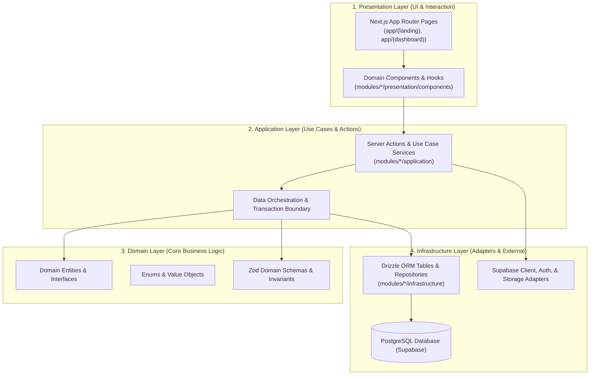

# Domain-Driven Design (DDD) Architecture

Dokumen ini mendefinisikan arsitektur sistem berbasis **Domain-Driven Design (DDD)** untuk platform **Kemas Prasasti 2025**.

---

## 1. Prinsip & Tujuan Penerapan DDD

Penerapan DDD bertujuan untuk:
1. **Memisahkan Kompleksitas Bisnis:** Menjaga logika inti kompetisi, pendaftaran, dan CMS blog tetap bersih dari dependensi framework (Next.js) dan library eksternal.
2. **Kemandirian Modul (High Cohesion, Loose Coupling):** Setiap domain memiliki batasan yang jelas (*Bounded Context*), antarmuka tipe sendiri, dan skema data tersendiri.
3. **Ubiquitous Language:** Menggunakan istilah bisnis yang seragam antara tim panitia, pengembang, dan kode program (misal: `Competition`, `Registration`, `VerificationStatus`, `Rulebook`).

---

## 2. Struktur Direktori Modular (`modules/`)

Setiap domain diorganisir ke dalam 4 lapisan (*layer*) standar:

```text
modules/
├── auth/                         # Bounded Context: Autentikasi & RBAC
│   ├── domain/                   # Entity, Value Objects, Role Enums, Zod Schemas
│   ├── application/              # Auth Services, Session Guard, Server Actions
│   ├── infrastructure/           # Drizzle User Table, Supabase Auth Repository
│   └── presentation/             # Komponen UI Login, Menu Profil Admin
│
├── competition/                  # Bounded Context: Katalog & Manajemen Lomba
│   ├── domain/                   # Competition Entity, Interface, Status, Zod Validation
│   ├── application/              # Use cases (List, Detail, Toggle Status, Update Rulebook)
│   ├── infrastructure/           # Drizzle Competition Table, Repository Data Access
│   └── presentation/             # CompetitionCard, Filter, RulebookDownload
│
├── registration/                 # Bounded Context: Pendaftaran & Verifikasi
│   ├── domain/                   # Registration Entity, Team Member, Verification Status
│   ├── application/              # Submit Registration, Verify, Reject, Export Data
│   ├── infrastructure/           # Drizzle Registration Table, Supabase Storage Proof Upload
│   └── presentation/             # Dynamic Registration Form, Proof Modal Preview, Action Buttons
│
├── blog/                         # Bounded Context: Publikasi & Web CMS
│   ├── domain/                   # BlogPost Entity, Category, Tag, Zod Schemas
│   ├── application/              # Post Use Cases (Create, Update, Publish, Slug Generator)
│   ├── infrastructure/           # Drizzle Blog Tables, Storage Media Uploader, Repository
│   └── presentation/             # Tiptap Editor, BlogCard, CategoryFilter
│
└── shared/                       # Cross-Cutting Concerns
    ├── domain/                   # Global Result Types, Pagination Types, Common Interfaces
    ├── application/              # Global Helpers & Error Handlers
    ├── infrastructure/
    │   ├── db/                   # Inisialisasi Drizzle ORM client (`client.ts`, `schema.ts`)
    │   └── supabase/             # Client Supabase browser, server, & middleware
    └── presentation/             # Komponen Dashboard Reusable (StatCard, Sidebar, Header)
```

---

## 3. Empat Lapisan DDD (The 4 Layers)



### A. Domain Layer (`domain/`)
- Lapisan terdalam yang murni berfokus pada aturan bisnis.
- **Dilarang keras** mengimpor library UI, React hooks, atau framework Next.js.
- Berisi: Entitas (`entity.ts`), interface kontrak data (`interface.ts`), enum nilai (`enum.ts`), dan aturan validasi Zod (`schema.ts`).

### B. Application Layer (`application/`)
- Mengorkestrasi aliran data untuk memenuhi kebutuhan use case spesifik.
- Bertindak sebagai jembatan antara permintaan dari UI dan model domain.
- Mengimplementasikan Next.js Server Actions dan memanggil repositori infrastruktur.

### C. Infrastructure Layer (`infrastructure/`)
- Mengimplementasikan akses ke teknologi eksternal:
  - Definisi tabel Drizzle ORM (`pgTable`).
  - Repositori query database (`db.select()`, `db.query`).
  - Pengunggahan berkas ke Supabase Storage.
  - Komunikasi otentikasi via Supabase Auth SDK.

### D. Presentation Layer (`presentation/`)
- Berisi komponen React khusus domain yang menggunakan CSS Tailwind & primitif Shadcn UI.
- Memanggil use cases / Server Actions dari lapisan Application.

---

## 4. Hubungan dengan Direktori Framework Lain

1. **`app/` (Next.js App Router):**
   - Bertindak sebagai *Routing, Layout, and Composition Layer*.
   - Halaman di `app/` mengimpor komponen dari `modules/<domain>/presentation/` atau memicu Server Actions di `modules/<domain>/application/`.
2. **`components/ui/`:**
   - Menyimpan seluruh primitif atomik **Shadcn UI** (`Button`, `Card`, `Table`, `Badge`, `Dialog`, dll.). Komponen ini berstatus murni (dumb components) tanpa logika bisnis.
3. **`db/`:**
   - Menyediakan titik kumpul terpusat bagi Drizzle ORM (`db/schema/index.ts` mengekspor seluruh tabel dari domain-domain untuk dibaca oleh `drizzle-kit`).
