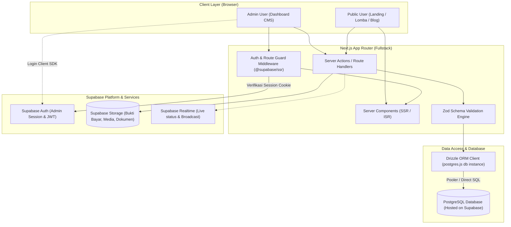

# System & Architecture Overview

Dokumen ini menjelaskan arsitektur teknis, aliran data, dan integrasi antar komponen di dalam platform **Kemas Prasasti 2025** yang menerapkan **Domain-Driven Design (DDD)** serta sepenuhnya mengadopsi **Supabase** dan **PostgreSQL** dengan **Drizzle ORM**.

> [!NOTE]
> Panduan rinci mengenai batasan domain (*Bounded Contexts*) dan 4 lapisan DDD diatur secara komprehensif dalam [ddd-architecture.md](file:///home/kinggu/Documents/Project/kemas-2025/docs/architechture/ddd-architecture.md).

---

## 1. Diagram Arsitektur Tingkat Tinggi



---

## 2. Peran Komponen Arsitektur

### A. Next.js 16 (App Router)
- **Routing Group:**
  - `(landing)`: Komponen publik dengan fokus optimasi SEO, Web Vitals, dan visual animasi.
  - `(detail)`: Halaman spesifik seperti rincian lomba dan artikel blog dengan Dynamic Metadata.
  - `(dashboard)`: Antarmuka dashboard admin yang diproteksi oleh Supabase Auth Session melalui Next.js Middleware.
- **Data Rendering Strategy:**
  - Landing page dan detail lomba menggunakan Server-Side Rendering (SSR) atau Incremental Static Regeneration (ISR) untuk performa instan.
  - Form pendaftaran dan dashboard admin menggunakan Client Components terisolasi yang berkomunikasi via Server Actions.

### B. Validasi dengan Zod
- Menjadi **single source of truth** untuk semua data yang masuk.
- Mencegah inkonsistensi tipe antara formulir di frontend dan payload di backend.
- Digunakan untuk formulir pendaftaran dinamis per kompetisi, manajemen admin, dan CMS blog.

### C. Supabase Platform & Services
- **Supabase Auth:**
  - Digunakan untuk autentikasi admin panel (email/password atau SSO).
  - Menggunakan library `@supabase/ssr` untuk manajemen sesi cookie yang aman, kompatibel dengan Server Components, Server Actions, dan Middleware.
- **Supabase Storage:**
  - Menyimpan unggahan berkas peserta (bukti transfer, scan kartu identitas, logo tim, pamflet lomba, gambar artikel).
  - Bucket dikelompokkan:
    - `registration-proofs`: Privat (dilindungi RLS, hanya admin dan pendaftar terkait yang dapat mengakses via Signed URL).
    - `blog-media`: Publik untuk gambar cover dan konten artikel.
    - `competition-assets`: Publik untuk pamflet dan rulebook PDF lomba.
- **Supabase Realtime:**
  - Sinkronisasi realtime status kuota pendaftaran kompetisi dan notifikasi aktivitas verifikasi di dashboard admin.

### D. PostgreSQL Database & Drizzle ORM
- **PostgreSQL:**
  - Menjadi database relasional utama (single source of truth) yang di-host di Supabase.
  - Mendukung transaksi ACID, relasi antar tabel (Peserta, Tim, Lomba, Pembayaran, Log Verifikasi, Artikel Blog).
- **Drizzle ORM:**
  - Data access layer TypeScript-first yang ultra-ringan, tanpa dependensi Rust/binary engine.
  - Skema tabel didefinisikan secara deklaratif di `db/schema/` menggunakan primitif PostgreSQL (`pgTable`, `varchar`, `timestamp`, `boolean`, dll.).
  - Query builder berkemampuan tinggi dengan dua gaya:
    1. **Relational Queries API (`db.query.*`):** Query hierarkis yang intuitif dan type-safe untuk relasi kompleks (misal pendaftaran beserta data anggota tim).
    2. **SQL-like API (`db.select().from(...).where(...)`):** Kontrol penuh atas query SQL dengan overhead mendekati nol.
  - Migrasi skema dikelola melalui `drizzle-kit` (`drizzle-kit generate` & `drizzle-kit migrate` / `drizzle-kit push`).
  - Inferensi tipe otomatis langsung dari tabel via `$inferSelect` dan `$inferInsert`.

---

## 3. Pola Integrasi Supabase, PostgreSQL & Drizzle ORM

Arsitektur ini sepenuhnya menyatukan data layer dan autentikasi ke dalam ekosistem PostgreSQL:

```
[Browser Form] 
       ↓ (Submit)
[Server Action] 
       ↓ (Validasi payload)
[Zod Schema] 
       ↓ (Query / Mutasi)
[Drizzle ORM (db)] 
       ↓ (postgres.js connection pool)
[PostgreSQL on Supabase]
```

1. **User Auth Flow:**
   - Admin login melalui form login -> Supabase Auth menerbitkan auth session cookies.
   - Middleware memeriksa auth session cookies menggunakan `@supabase/ssr`. Jika belum terotentikasi, redirect ke `/login`.
2. **File Upload Flow:**
   - Berkas pendaftaran/media blog diunggah ke Supabase Storage via Server Action atau Supabase Client.
   - URL path atau storage key disimpan ke PostgreSQL melalui Drizzle ORM.
3. **Data Mutation Flow:**
   - Input pendaftar divalidasi oleh Zod -> Disimpan ke PostgreSQL melalui Drizzle ORM dengan jaminan integritas relasional (foreign keys).
