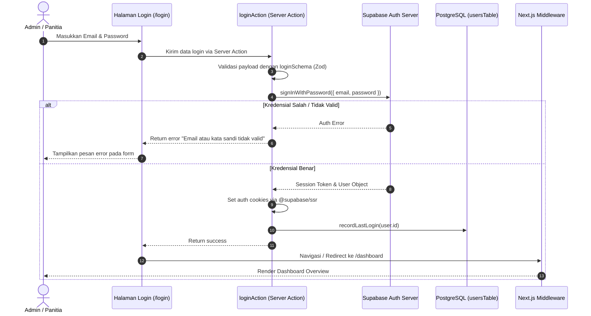
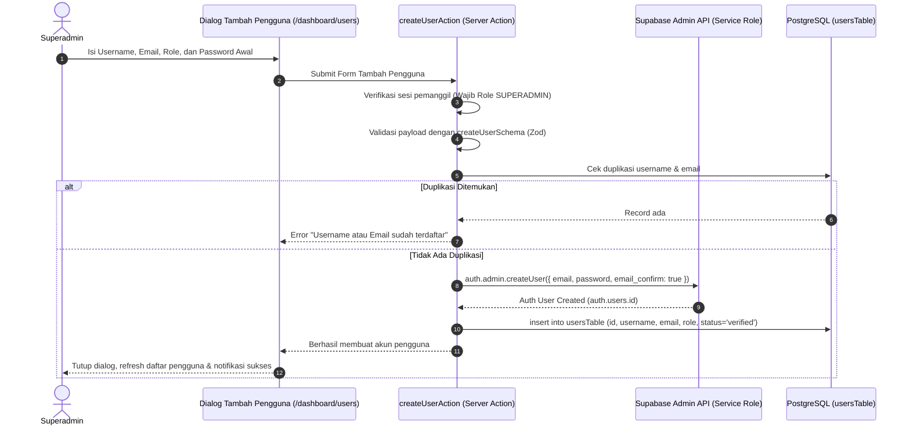
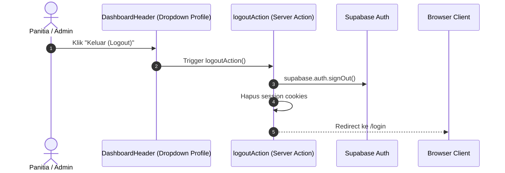

# Spesifikasi Fitur: Autentikasi & Manajemen Pengguna (Supabase Auth)

Dokumen ini mendefinisikan rancangan teknis, arsitektur aliran data, hak akses (RBAC), serta spesifikasi implementasi modul **Autentikasi & User Management** untuk platform **Kemas Prasasti 2025**.

---

## 1. Latar Belakang & Kebijakan Sistem

1. **Penggunaan Supabase Auth:**
   - Seluruh mekanisme otentikasi identitas, session management berbasis secure HTTP-only cookies, dan token hashing dikelola oleh **Supabase Auth** melalui pustaka `@supabase/ssr`.
2. **Tidak Ada Fitur Registrasi Publik (*No Public Registration*):**
   - Platform Kemas Prasasti 2025 adalah sistem tertutup untuk kepanitiaan (Admin Panel & CMS).
   - Publik atau peserta lomba tidak memiliki akses registrasi akun mandiri.
   - Tidak ada rute `/register` atau form pendaftaran akun umum.
3. **Pendaftaran Pengguna Hanya oleh Superadmin (*Add User via Superadmin*):**
   - Penambahan akun baru (Admin, CMS Writer, atau sesama Superadmin) **hanya dapat dilakukan oleh pengguna dengan peran `SUPERADMIN`** melalui dashboard `/dashboard/users`.
   - Pembuatan akun memanfaatkan **Supabase Admin Auth API** (`supabase.auth.admin.createUser`) via `SUPABASE_SERVICE_ROLE_KEY` di server runtime.
   - Akun yang dibuat oleh Superadmin otomatis berstatus terverifikasi (`email_confirm: true`) dengan password awal yang ditentukan oleh Superadmin.
   - Data profil pengguna otomatis disinkronkan ke tabel PostgreSQL `users` (`usersTable`) menggunakan ID yang sama dengan `auth.users.id`.
4. **Proteksi Rute Menyeluruh (*Route Protection Middleware*):**
   - Seluruh rute di bawah `/dashboard/*` diproteksi secara ketat menggunakan Next.js Middleware.
   - Pengguna tanpa sesi aktif akan dialihkan (*redirect*) ke halaman `/login`.
   - Pengguna yang sudah login akan dialihkan langsung ke `/dashboard` jika membuka halaman `/login`.

---

## 2. Alur Pengguna (User Flow)

### A. Alur Login (Sign In Flow)


### B. Alur Tambah Pengguna oleh Superadmin (Add User Flow)


### C. Alur Keluar Akun (Logout Flow)


---

## 3. Struktur Hak Akses (Role-Based Access Control)

| Role | Login ke Dashboard | Akses CMS Blog | Verifikasi Lomba & Registrasi | Kelola Pengguna (Add/Edit/Delete User) |
| :--- | :---: | :---: | :---: | :---: |
| **SUPERADMIN** | ✅ Ya | ✅ Ya | ✅ Ya | ✅ **Ya (Eksklusif)** |
| **ADMIN** | ✅ Ya | ✅ Ya | ✅ Ya | ❌ Tidak (Read-only list atau hidden) |
| **CMS_WRITER** | ✅ Ya | ✅ Ya | ❌ Tidak | ❌ Tidak |

---

## 4. Arsitektur Domain-Driven Design (DDD) untuk Bounded Context `auth`

Modul `auth` dipetakan ke dalam 4 lapisan DDD:

```text
modules/auth/
├── domain/
│   ├── role.enum.ts              # Enum peran: SUPERADMIN, ADMIN, CMS_WRITER
│   ├── user-status.enum.ts       # Enum status: verified, unverified
│   ├── user.entity.ts            # Tipe entitas User dan SessionUser
│   ├── auth.schema.ts            # Zod schema: loginSchema, createUserWithPasswordSchema
│   └── user.schema.ts            # Zod schema untuk profil dan form update
├── application/
│   ├── auth.actions.ts           # Server Actions: loginAction, logoutAction, getCurrentUserAction
│   └── user.actions.ts           # Server Actions: createUserAction, updateUserAction, deleteUserAction
├── infrastructure/
│   ├── user.table.ts             # Skema Drizzle ORM PostgreSQL (`usersTable`)
│   ├── user.repository.ts        # Query database PostgreSQL via Drizzle
│   └── auth.service.ts           # Adapter Supabase Auth (Sign In, Sign Out, Admin API)
└── presentation/
    └── components/
        ├── login-form.tsx        # Form Login responsif dengan Shadcn UI
        ├── user-dialog.tsx       # Dialog Tambah/Edit Pengguna (dengan field password)
        └── user-table.tsx        # Tabel manajemen pengguna & aksi Superadmin
```

---

## 5. Rincian Skema & Validasi Data (Zod)

### A. Skema Login (`auth.schema.ts`)
```typescript
import { z } from "zod";

export const loginSchema = z.object({
  email: z
    .string()
    .min(1, "Email wajib diisi")
    .email("Format email tidak valid"),
  password: z
    .string()
    .min(6, "Kata sandi minimal 6 karakter"),
});

export type LoginInput = z.infer<typeof loginSchema>;
```

### B. Skema Tambah Pengguna Baru oleh Superadmin
```typescript
export const createUserWithPasswordSchema = z.object({
  username: z
    .string()
    .min(3, "Username minimal 3 karakter")
    .max(50, "Username maksimal 50 karakter")
    .regex(/^[a-zA-Z0-9_.-]+$/, {
      message: "Username hanya boleh huruf, angka, titik, underscore, dan strip",
    }),
  email: z
    .string()
    .min(1, "Email wajib diisi")
    .email("Format email tidak valid"),
  password: z
    .string()
    .min(8, "Kata sandi awal minimal 8 karakter"),
  role: z.enum(["SUPERADMIN", "ADMIN", "CMS_WRITER"], {
    message: "Pilih peran pengguna yang valid",
  }),
});

export type CreateUserWithPasswordInput = z.infer<typeof createUserWithPasswordSchema>;
```

---

## 6. Rate Limiting & Proteksi Brute Force Login

Sesuai aturan keamanan:
- **Ketentuan Percobaan:** Maksimal **3 kali percobaan login gagal dalam rentang waktu 1 menit**.
- **Konsekuensi Pelanggaran:** Jika gagal 3 kali berturut-turut dalam 1 menit, akun/identifier akan **dikunci (lockout) selama 10 menit**.
- **Mekanisme Penyimpanan:** Disimpan di tabel database `login_attempts`:
  - `identifier`: email atau IP pengguna.
  - `attempts`: penghitung percobaan gagal.
  - `last_attempt_at`: timestamp percobaan terakhir.
  - `locked_until`: timestamp hingga waktu lockout selesai (10 menit sejak percobaan gagal ke-3).
- **Alur Validasi Rate Limit:**
  1. Sebelum memproses `signInWithPassword`, periksa apakah `locked_until` masih berlaku (`locked_until > now()`). Jika ya, tolak login dan beri tahu sisa menit yang harus ditunggu.
  2. Jika percobaan terakhir sudah lebih dari 1 menit yang lalu dan belum pernah ter-lock, reset counter `attempts = 0`.
  3. Jika percobaan login gagal, increment `attempts`. Jika `attempts >= 3`, set `locked_until = now() + 10 minutes`.
  4. Jika login berhasil, bersihkan (*clear*) data percobaan untuk identifier tersebut.

---

## 7. Desain Antarmuka Login (`app/login/page.tsx`)

- **Komponen Shadcn UI yang Digunakan:**
  - `Card`, `CardHeader`, `CardTitle`, `CardDescription`, `CardContent`, `CardFooter`
  - `Input` & `Label`
  - `Button` dengan state loading spinner
  - Visual branding khas Kemas Prasasti 2025 (warna primary brand, logo maskot, dan background subtle gradient).
- **Fitur Tambahan:**
  - Toggle show/hide password (ikon Eye / EyeOff).
  - Pesan error inline jika otentikasi gagal atau akun terkena lockout 10 menit.
  - Redirect otomatis ke rute tujuan semula (`?next=/dashboard/...`) setelah berhasil login.

---

## 8. Middleware Session Guard & Proteksi Controller Server Actions

1. **Middleware Guard (`middleware.ts`):**
   - Middleware berjalan di edge runtime untuk menyinkronkan token via `@supabase/ssr` (`updateSession`).
   - Jika rute `/dashboard/*` diakses tanpa sesi aktif: redirect ke `/login?next=${pathname}`.
   - Jika rute `/login` diakses oleh pengguna yang sudah memiliki sesi aktif: redirect ke `/dashboard`.
   - Mempertahankan penanganan URL usang / legacy (HTTP 410 Gone) yang sudah ada sebelumnya.

2. **Server Action Controller Protection (Defense in Depth):**
   - Seluruh Server Action controller untuk mutasi data di dashboard (Create, Update, Delete pada `user.actions.ts`, `blog.actions.ts`, `competition.actions.ts`, `registration.actions.ts`) **wajib memanggil guard `requireAuthUser()`** di awal eksekusi.
   - Jika sesi tidak valid, aksi akan langsung mengembalikan error `{ success: false, error: "Tidak memiliki hak akses / sesi telah berakhir" }`.

---

## 9. Inisialisasi Akun Superadmin Awal (First-Time Seeding)

Karena fitur registrasi publik tidak tersedia, akun Superadmin pertama akan disediakan melalui skrip seeder administratif:
- Perintah: `pnpm db:seed-superadmin` atau dieksekusi sekali melalui script `scripts/seed-superadmin.ts`.
- Membaca kredensial default dari `.env` (misal `SUPERADMIN_EMAIL` & `SUPERADMIN_PASSWORD`).
- Membuat entitas di `auth.users` Supabase dan tabel PostgreSQL `users` dengan peran `SUPERADMIN` dan status `verified`.
- Dengan ini, tim developer atau pemilik sistem dapat langsung login pertama kali dan mengelola sistem.

---

## 10. Status & Tahapan Pekerjaan

- [x] **Tahap 1: Analisis Kebutuhan & Dokumen Perencanaan** (Dokumen `docs/feateures/auth-feature.md` selesai dirancang)
- [x] **Tahap 2: Konfirmasi & Persetujuan Pengguna** (Disetujui: Login, Middleware Guard, Controller Protection, Rate Limit 3x/1menit -> 10 menit lockout)
- [x] **Tahap 3: Implementasi Skema Rate Limit & Domain Zod** (`login_attempts` table, `auth.schema.ts`, migrasi `0004_absurd_starjammers.sql`)
- [x] **Tahap 4: Implementasi Lapisan Infrastruktur & Service** (`login-attempt.repository.ts`, `lib/supabase/server.ts`)
- [x] **Tahap 5: Implementasi Lapisan Application & Server Actions** (`auth.actions.ts`, `auth.guard.ts` `requireAuthUser` & `requireSuperadmin`, integrasi `user.actions.ts` & `blog.actions.ts`)
- [x] **Tahap 6: Implementasi Middleware Guard** (`middleware.ts` berbasis `@supabase/ssr` untuk proteksi `/dashboard/*`, redirect `/login`, dan legacy 410 URLs)
- [x] **Tahap 7: Implementasi Halaman Login UI & Perbaruan User Dialog** (`app/(auth)/login/page.tsx`, `login-form.tsx`, `user-dialog.tsx` dengan password field, `DashboardHeader.tsx` profil dinamis & logout)
- [x] **Tahap 8: Skrip Seeder Superadmin & Verifikasi Menyeluruh** (`pnpm db:seed-superadmin`, pengujian rate limiting 100% lulus, `next build` berhasil)
