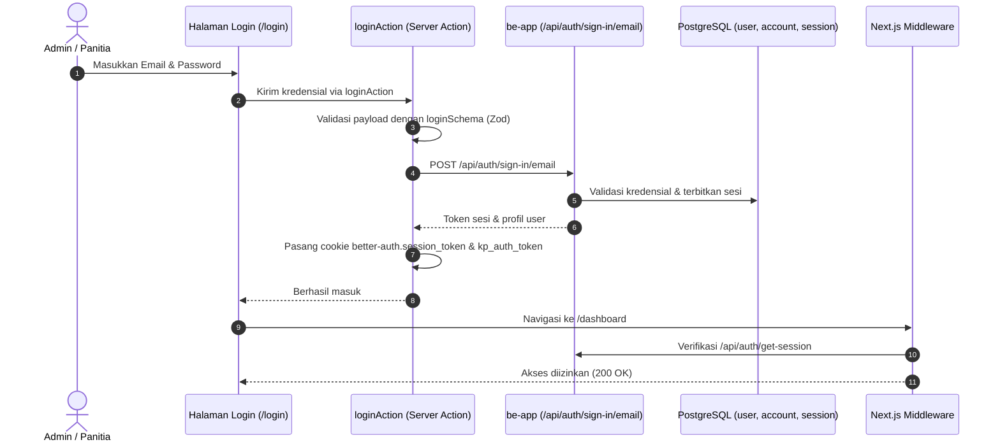
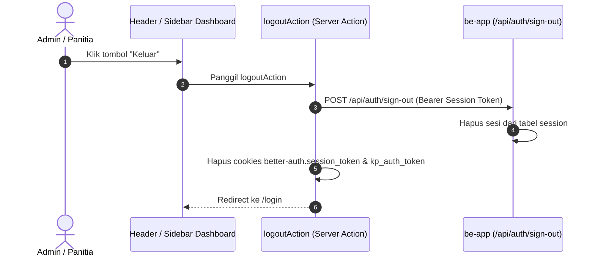

# Spesifikasi Fitur: Autentikasi & Manajemen Pengguna (Better Auth)

Dokumen ini mendefinisikan rancangan teknis, arsitektur aliran data, hak akses (RBAC), serta spesifikasi implementasi modul **Autentikasi & User Management** untuk platform **Kemas Prasasti 2025** menggunakan **Better Auth** pada backend Express.js dan frontend Next.js.

---

## 1. Latar Belakang & Kebijakan Sistem

1. **Penggunaan Better Auth:**
   - Seluruh mekanisme otentikasi identitas, session management berbasis secure HTTP-only cookies (`better-auth.session_token`), dan credential hashing dikelola oleh **Better Auth** via Drizzle ORM Adapter di `be-app` (Express.js pada port 5000).
   - Di frontend (`fe-app`), integrasi dilakukan melalui Better Auth React Client (`@/lib/auth-client.ts`) serta Server Action `loginAction` dan `logoutAction`.
2. **Tidak Ada Fitur Registrasi Publik (*No Public Registration*):**
   - Platform Kemas Prasasti 2025 adalah sistem tertutup untuk kepanitiaan (Admin Panel & CMS).
   - Publik atau peserta lomba tidak memiliki akses registrasi akun mandiri.
   - Tidak ada rute `/register` atau form pendaftaran akun umum.
3. **Pendaftaran Pengguna Hanya oleh Superadmin (*Add User via Superadmin*):**
   - Penambahan akun baru (Admin, CMS Writer, atau sesama Superadmin) **hanya dapat dilakukan oleh pengguna dengan peran `SUPERADMIN`** melalui dashboard `/dashboard/users`.
   - Superadmin menginput `username`, `email`, dan `role`.
   - Akun dibuat di database PostgreSQL pada tabel `user` dengan status awal `unverified`.
   - Sistem menerbitkan token verifikasi aman dengan masa berlaku 12 jam dan mengirimkannya melalui email undangan via SMTP Mailpit/production.
4. **Proteksi Rute Dashboard (*Route Protection & Session Verification*):**
   - Seluruh rute di bawah `/dashboard/*` diproteksi secara ketat menggunakan Next.js Middleware.
   - Middleware membaca cookie `better-auth.session_token` dan memvalidasinya langsung ke endpoint backend `/api/auth/get-session` (atau fallback `/api/auth/me`).
   - Sesi yang tidak valid atau telah kedaluwarsa akan dihapus cookies-nya dan dialihkan ke `/login?expired=1`.
   - Pengguna dengan sesi valid yang mengunjungi `/login` otomatis dialihkan ke `/dashboard`.
5. **Autentikasi Server-to-Server / Server Actions:**
   - Server Actions dan API Client (`lib/api-client.ts`) menyematkan session token pada header `Authorization: Bearer <token>` dan `Cookie: better-auth.session_token=<token>`, yang secara instan diverifikasi oleh plugin `bearer()` pada Better Auth `be-app`.

---

## 2. Alur Pengguna (User Flow)

### A. Alur Login (Sign In Flow)

### B. Alur Keluar (Sign Out Flow)

