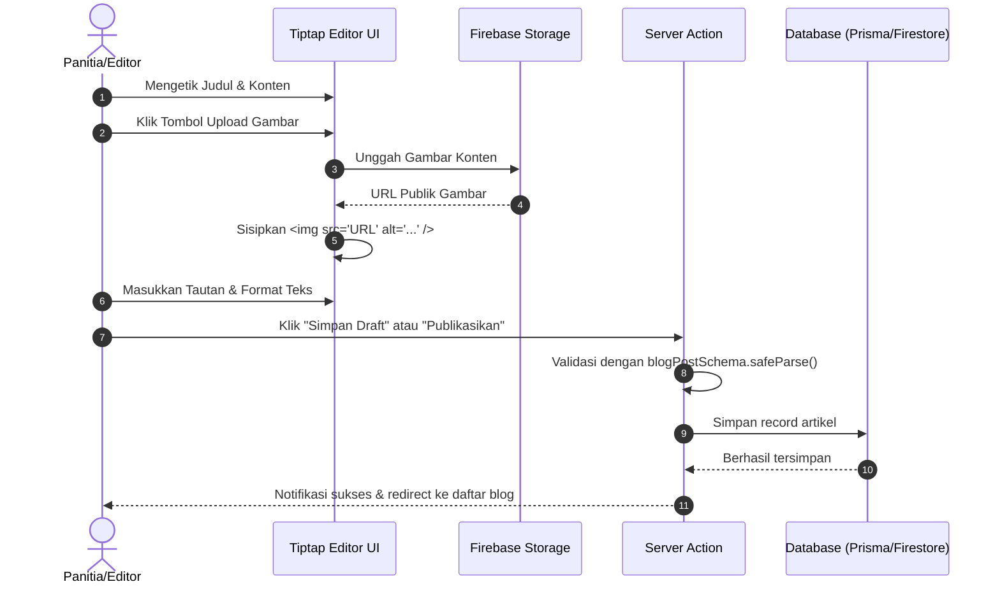

# Spesifikasi Fitur: Web CMS & Blog dengan Tiptap Editor

Dokumen ini mendefinisikan rancangan, arsitektur data, spesifikasi antarmuka, dan integrasi **Tiptap Rich Text Editor** untuk modul **Blog & Publikasi Kegiatan Kemas Prasasti 2025**.

---

## 1. Ringkasan & Tujuan Fitur

Modul Blog dirancang sebagai media publikasi terpusat untuk:
- Rilis berita kegiatan, artikel edukatif, profil acara, dokumentasi visual, dan pengumuman lomba.
- Memberikan pengalaman menulis yang intuitif bagi admin/penulis (*content writer*) melalui **Tiptap Rich Text Editor** yang fleksibel dan mendukung penyematan tautan (links) serta gambar (images).
- Menghadirkan halaman baca artikel yang rapi, cepat, responsif, dan ramah SEO di sisi publik.

---

## 2. Struktur Rute & Navigasi

### A. Sisi Dashboard Admin (`app/(dashboard)`)
```text
app/(dashboard)/dashboard/
├── page.tsx                       # Overview metrik (termasuk counter artikel & blog recent)
└── blog/
    ├── page.tsx                   # Daftar semua artikel (tabel, filter status/kategori, aksi)
    ├── create/page.tsx            # Form pembuatan artikel baru (dengan Tiptap Editor)
    └── [id]/edit/page.tsx         # Form perbarui artikel yang sudah ada
```

### B. Sisi Publik (`app/(landing)` & `app/(detail)`)
```text
app/
├── (landing)/blog/page.tsx        # Katalog artikel publik (pencarian, kategori, kartu blog)
└── (detail)/blog/[slug]/page.tsx  # Halaman detail baca artikel (SEO metadata, reader mode)
```

---

## 3. Spesifikasi Tiptap Rich Text Editor

### A. Dependensi yang Dibutuhkan (`pnpm`)
- Core: `@tiptap/react`, `@tiptap/pm`
- Extensions:
  - `@tiptap/starter-kit` (Bold, Italic, Strike, Code, Heading 1-3, Paragraph, Bullet List, Ordered List, Blockquote, Horizontal Rule, History Undo/Redo)
  - `@tiptap/extension-link` (Tautan hiperteks dengan protocol validation & target `_blank`)
  - `@tiptap/extension-image` (Inline & centered images dengan atribut `alt` dan `title`)
  - `@tiptap/extension-placeholder` (Tampilan placeholder teks: *"Mulai tulis cerita kegiatan di sini..."*)

### B. Komponen Toolbar Editor (`components/features/blog/editor-toolbar.tsx`)
Toolbar ditempatkan di atas area penulisan dengan tombol-tombol interaktif:

```text
[ Undo | Redo ] | [ Bold | Italic | Strike | Code ] | [ H1 | H2 | H3 ] | [ Bullet List | Numbered List ] | [ Blockquote | Divider ] | [ 🔗 Link ] | [ 🖼️ Upload Gambar ]
```

1. **Format Teks Standar:**
   - Bold (`Cmd+B` / `Ctrl+B`)
   - Italic (`Cmd+I` / `Ctrl+I`)
   - Strikethrough
   - Heading dropdown: H1 (Judul Bagian), H2 (Sub-judul), H3 (Poin Penting).
2. **List & Kutipan:**
   - Bullet list & Numbered list dengan indentasi rapi.
   - Blockquote untuk kutipan sambutan panitia / tokoh.
   - Horizontal rule (`---`) untuk pemisah bagian tulisan.
3. **Penyisipan Tautan (Insert Link):**
   - Popover dialog ketika tombol Link ditekan atau teks diblok:
     - Field input URL (misal: `https://...`).
     - Checkbox: *Buka di tab baru (`target="_blank"`)*.
     - Tombol *Terapkan* dan *Hapus Tautan*.
4. **Penyisipan Gambar (Insert Image):**
   - **Mode 1 (Upload Berkas):** Pilih file gambar dari komputer &rarr; otomatis terunggah ke Firebase Storage folder `/blogs/content/` &rarr; URL gambar disisipkan ke posisi kursor editor.
   - **Mode 2 (URL Eksternal):** Masukkan link gambar langsung.
   - Dilengkapi atribut `alt` untuk aksesibilitas dan optimasi SEO gambar.

---

## 4. Skema Data & Kontrak Zod

### A. TypeScript Interface (`types/blog.interface.ts`)
```typescript
export type BlogStatus = 'DRAFT' | 'PUBLISHED' | 'ARCHIVED';

export interface IBlogPost {
  id: string;
  title: string;
  slug: string;
  excerpt: string;
  content: string; // HTML string hasil getHTML() dari Tiptap
  coverImage?: string; // URL Firebase Storage
  category: string;
  tags: string[];
  authorId: string;
  authorName: string;
  status: BlogStatus;
  readingTime?: string;
  publishedAt?: Date | null;
  createdAt: Date;
  updatedAt: Date;
}
```

### B. Validasi Schema Zod (`schema/blog.schema.ts`)
```typescript
import { z } from 'zod';

export const blogPostSchema = z.object({
  title: z
    .string()
    .min(5, 'Judul artikel minimal 5 karakter')
    .max(150, 'Judul artikel maksimal 150 karakter'),
  slug: z
    .string()
    .min(3, 'Slug minimal 3 karakter')
    .regex(/^[a-z0-9]+(?:-[a-z0-9]+)*$/, 'Format slug tidak valid (gunakan huruf kecil dan tanda minus)'),
  excerpt: z
    .string()
    .min(20, 'Ringkasan minimal 20 karakter')
    .max(300, 'Ringkasan maksimal 300 karakter'),
  content: z
    .string()
    .min(50, 'Konten artikel minimal 50 karakter'),
  coverImage: z
    .string()
    .url('Format URL gambar sampul tidak valid')
    .optional(),
  category: z
    .string()
    .min(1, 'Pilih salah satu kategori'),
  tags: z
    .array(z.string())
    .min(1, 'Minimal tambahkan 1 tag')
    .max(5, 'Maksimal 5 tag'),
  status: z.enum(['DRAFT', 'PUBLISHED', 'ARCHIVED']),
});

export type BlogPostFormInput = z.infer<typeof blogPostSchema>;
```

---

## 5. Alur Kerja Admin Menulis Blog



---

## 6. Rendering & Keamanan (Sanitasi HTML & Styling)

1. **Styling Konten (Typography):**
   - Di sisi pembaca publik (`/blog/[slug]`), konten HTML dari Tiptap akan dirender di dalam kontainer berkelas Tailwind typography: `prose dark:prose-invert max-w-none`.
   - Mengatur tampilan heading yang tegas, blockquote elegan, dan gambar responsif (*max-w-full rounded-lg*).
2. **Keamanan (XSS Prevention):**
   - Sebelum konten HTML dirender di browser pembaca, lakukan sanitasi menggunakan library seperti `isomorphic-dompurify` untuk membersihkan tag berbahaya (misal: `<script>`, `onerror=`, `iframe` asing).
3. **SEO & Metadata:**
   - Setiap artikel publik menghasilkan `generateMetadata`:
     - `title`: Judul Artikel - Kemas Prasasti 2025
     - `description`: Excerpt artikel
     - `openGraph`: Gambar sampul (`coverImage`), URL kanonikal, tipe `article`.

---

## 7. Rencana Tahapan Implementasi (Setelah Persetujuan)

- [ ] **Langkah 1:** Instalasi dependensi Tiptap via `pnpm` (`@tiptap/react`, `@tiptap/pm`, `@tiptap/starter-kit`, `@tiptap/extension-link`, `@tiptap/extension-image`, `@tiptap/extension-placeholder`).
- [ ] **Langkah 2:** Pembuatan tipe data di `types/blog.interface.ts` dan skema Zod di `schema/blog.schema.ts`.
- [ ] **Langkah 3:** Pembuatan komponen reusable Tiptap editor (`components/features/blog/tiptap-editor.tsx` & `toolbar.tsx`).
- [ ] **Langkah 4:** Setup upload handler gambar ke Firebase Storage.
- [ ] **Langkah 5:** Implementasi halaman form create/edit di `app/(dashboard)/dashboard/blog/`.
- [ ] **Langkah 6:** Integrasi data service / Server Action untuk penyimpanan artikel.
