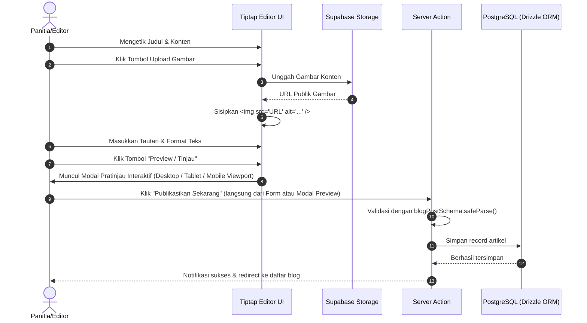

# Spesifikasi Fitur: Web CMS & Blog dengan Tiptap Editor

Dokumen ini mendefinisikan rancangan, arsitektur data, spesifikasi antarmuka, dan integrasi **Tiptap Rich Text Editor** untuk modul **Blog & Publikasi Kegiatan Kemas Prasasti 2025**.

---

## 1. Ringkasan & Tujuan Fitur

Modul Blog dirancang sebagai media publikasi terpusat untuk:
- Rilis berita kegiatan, artikel edukatif, profil acara, dokumentasi visual, dan pengumuman lomba.
- Memberikan pengalaman menulis yang intuitif bagi admin/penulis (*content writer*) melalui **Tiptap Rich Text Editor** yang fleksibel dan mendukung penyematan tautan (links) serta gambar (images).
- Menghadirkan halaman baca artikel yang rapi, cepat, responsif, dan ramah SEO di sisi publik.

---

## 2. Struktur Rute & Navigasi

### A. Sisi Dashboard Admin (`app/(dashboard)`)
```text
app/(dashboard)/dashboard/
├── page.tsx                       # Overview metrik (termasuk counter artikel & blog recent)
└── blog/
    ├── page.tsx                   # Daftar semua artikel (tabel, filter status/kategori, aksi)
    ├── create/page.tsx            # Form pembuatan artikel baru (dengan Tiptap Editor)
    └── [id]/edit/page.tsx         # Form perbarui artikel yang sudah ada
```

### B. Sisi Publik (`app/(landing)` & `app/(detail)`)
```text
app/
├── (landing)/blog/page.tsx        # Katalog artikel publik (pencarian, kategori, kartu blog)
└── (detail)/blog/[slug]/page.tsx  # Halaman detail baca artikel (SEO metadata, reader mode)
```

---

## 3. Spesifikasi BlockNote (Notion-Style Block Editor)

### A. Dependensi yang Digunakan (`pnpm`)
- Core & React: `@blocknote/core`, `@blocknote/react`
- UI Integration: `@blocknote/shadcn` (integrasi langsung dengan Shadcn design tokens & Tailwind CSS v4)

### B. Fitur & Pengalaman Menulis (Notion-Like Experience)
1. **Full-page Notion Canvas:** Penulisan 1 halaman penuh tanpa batas kartu yang kaku, dilengkapi auto-expanding title dan panel properti halaman (Tag/Kategori, Status Komentar, Catatan Redaksi).
2. **Slash Command (`/`):** Tekan `/` untuk memunculkan command menu kontekstual (Heading 1-3, Bullet List, Numbered List, Checklist, Quote, Code Block, Table, Divider, Gambar).
3. **Per-Block Editing & Drag Handle:** Setiap paragraf atau blok dapat digeser/dipindahkan dengan drag handle (`::`) atau ditambah dengan tombol `+`.
4. **Floating Format Toolbar:** Muncul otomatis saat teks diseleksi (Bold, Italic, Strikethrough, Underline, Code, Text Color, Background Color, Create Link).
5. **Konversi Dua Arah Type-Safe:**
   - Database HTML -> BlockNote Blocks (`editor.tryParseHTMLToBlocks(html)`)
   - BlockNote Blocks -> Database Clean HTML (`editor.blocksToHTMLLossy(editor.document)`)
   - Blockquote untuk kutipan sambutan panitia / tokoh.
   - Horizontal rule (`---`) untuk pemisah bagian tulisan.
3. **Penyisipan Tautan (Insert Link):**
   - Popover dialog ketika tombol Link ditekan atau teks diblok:
     - Field input URL (misal: `https://...`).
     - Checkbox: *Buka di tab baru (`target="_blank"`)*.
     - Tombol *Terapkan* dan *Hapus Tautan*.
4. **Penyisipan Gambar & Manajemen Berkas (Deferred Upload & Storage Diffing):**
   - **Deferred Upload (Optimistic Preview):**
     - Saat memilih gambar, browser membuat lokal `blob:` Object URL untuk preview instan tanpa latency jaringan.
     - Berkas disimpan di memori sementara (`pendingImagesRef`).
     - Jika gambar dihapus dari kanvas atau pembuatan artikel dibatalkan, **nol bytes masuk ke storage**, mencegah berkas sampah (*orphan files*).
     - Saat tombol **"Publikasikan"** atau **"Simpan Perubahan"** ditekan, hanya gambar yang *aktif ada* di dokumen yang diunggah bersamaan ke Supabase Storage, lalu URL lokal `blob:` digantikan secara atomik dengan URL publik Supabase Storage.
   - **Validasi Berkas:**
     - **Batas Ukuran:** Maksimal **3 MB** (divalidasi di sisi klien dan Server Action).
     - **Format yang Didukung:** PNG, JPG, JPEG, WebP, GIF, SVG.
   - **Sinkronisasi Pembersihan Otomatis (Storage Diffing):**
     - **Saat Edit Artikel:** Sistem membandingkan gambar lama vs baru. Gambar yang dihapus dari artikel lama otomatis dihapus dari bucket Supabase Storage.
     - **Saat Hapus Artikel:** Seluruh berkas gambar yang terkait dengan artikel tersebut otomatis dibersihkan dari bucket Supabase Storage.

---

## 4. Skema Data & Kontrak Zod

### A. TypeScript Interface (`types/blog.interface.ts`)
```typescript
export type BlogStatus = 'DRAFT' | 'PUBLISHED' | 'ARCHIVED';

export interface IBlogPost {
  id: string;
  title: string;
  slug: string;
  excerpt: string;
  content: string; // HTML string hasil getHTML() dari Tiptap
  coverImage?: string; // URL Supabase Storage
  category: string;
  tags: string[];
  authorId: string;
  authorName: string;
  status: BlogStatus;
  readingTime?: string;
  publishedAt?: Date | null;
  createdAt: Date;
  updatedAt: Date;
}
```

### B. Skema Database Drizzle (`modules/blog/infrastructure/blog.table.ts`)

#### 1. Tabel `blogs`
```typescript
export const blogsTable = pgTable("blogs", {
  id: uuid("id").defaultRandom().primaryKey(),
  title: varchar("title", { length: 255 }).notNull(),
  description: text("description").notNull(),
  tag: varchar("tag", { length: 255 }),
  status: varchar("status", { length: 20 }).default("PUBLIC").notNull(), // 'PUBLIC' | 'PRIVATE'
  commentStatus: boolean("comment_status").default(true).notNull(),
  createdAt: timestamp("created_at", { withTimezone: true }).defaultNow().notNull(),
  updatedAt: timestamp("updated_at", { withTimezone: true }).defaultNow().$onUpdate(() => new Date()).notNull(),
});
```

#### 2. Tabel `comments` (One-to-Many Relasi dengan `blogs`)
```typescript
export const commentsTable = pgTable("comments", {
  id: uuid("id").defaultRandom().primaryKey(),
  blogId: uuid("blog_id")
    .notNull()
    .references(() => blogsTable.id, { onDelete: "cascade" }),
  name: varchar("name", { length: 150 }).notNull(),
  email: varchar("email", { length: 255 }),
  content: text("content").notNull(),
  isApproved: boolean("is_approved").default(true).notNull(),
  createdAt: timestamp("created_at", { withTimezone: true }).defaultNow().notNull(),
  updatedAt: timestamp("updated_at", { withTimezone: true }).defaultNow().$onUpdate(() => new Date()).notNull(),
});
```

### C. Validasi Schema Zod (`modules/blog/domain/blog.schema.ts`)
```typescript
import { z } from "zod";

export const blogFormSchema = z.object({
  title: z
    .string()
    .min(5, "Judul artikel minimal 5 karakter")
    .max(255, "Judul artikel maksimal 255 karakter"),
  description: z
    .string()
    .min(10, "Konten/deskripsi artikel minimal 10 karakter"),
  tag: z.string().max(255).optional().nullable(),
  commentStatus: z.boolean().default(true),
});

export type BlogFormInput = z.infer<typeof blogFormSchema>;
```

---

## 5. Alur Kerja Admin Menulis Blog



### B. Fitur Review & Preview Sebelum Publish
1. **Interactive Preview Modal (`BlogPreviewModal`):**
   - Menggunakan komponen dialog Shadcn (`components/ui/dialog`).
   - Dilengkapi **Device Viewport Switcher** (Desktop: 100%, Tablet: 768px, Mobile: 390px) untuk meninjau keterbacaan artikel di berbagai ukuran layar.
   - Perhitungan estimasi waktu baca (*reading time*) otomatis secara dinamis berdasarkan total kata.
   - Penampilan judul, tanggal penerbitan, daftar hashtag, status komentar, dan styling konten HTML.
   - Tombol aksi terintegrasi di dalam modal: "Kembali Edit" dan "Publikasikan Sekarang".
2. **Ketersediaan Tombol Preview:**
   - Di `blog-form.tsx`: Tersedia di sebelah tombol Simpan/Publikasikan.
   - Di `blog-table.tsx`: Tersedia pada dropdown aksi per baris artikel untuk meninjau artikel yang telah tersimpan tanpa perlu masuk mode edit.

---

## 6. Rendering & Keamanan (Sanitasi HTML & Styling)

1. **Styling Konten (Typography):**
   - Di sisi pembaca publik (`/blog/[slug]`), konten HTML dari Tiptap akan dirender di dalam kontainer berkelas Tailwind typography: `prose dark:prose-invert max-w-none`.
   - Mengatur tampilan heading yang tegas, blockquote elegan, dan gambar responsif (*max-w-full rounded-lg*).
2. **Keamanan (XSS Prevention):**
   - Sebelum konten HTML dirender di browser pembaca, lakukan sanitasi menggunakan library seperti `isomorphic-dompurify` untuk membersihkan tag berbahaya (misal: `<script>`, `onerror=`, `iframe` asing).
3. **SEO & Metadata:**
   - Setiap artikel publik menghasilkan `generateMetadata`:
     - `title`: Judul Artikel - Kemas Prasasti 2025
     - `description`: Excerpt artikel
     - `openGraph`: Gambar sampul (`coverImage`), URL kanonikal, tipe `article`.

---

## 7. Rencana & Status Tahapan Implementasi

- [x] **Langkah 1:** Instalasi dependensi BlockNote via `pnpm` (`@blocknote/core`, `@blocknote/react`, `@blocknote/shadcn`) dan penghapusan total paket TipTap lama.
- [x] **Langkah 2:** Pembuatan skema database Drizzle (`db/schema/blog.schema.ts`) dengan koneksi langsung ke Supabase PostgreSQL & migrasi skema tabel `blogs`.
- [x] **Langkah 3:** Pembuatan domain entity, skema Zod, repository, dan Server Actions di `modules/blog/`.
- [x] **Langkah 4:** Pembuatan komponen editor Notion-style menggunakan BlockNote (`modules/blog/presentation/components/blocknote-editor.tsx`).
- [x] **Langkah 5:** Implementasi kanvas halaman Notion di `blog-form.tsx` dan integrasi halaman create/edit di `app/(dashboard)/dashboard/blog/`.
- [x] **Langkah 6:** Integrasi data table admin di `app/(dashboard)/dashboard/blog/page.tsx` dengan fitur read, pagination, dan delete Server Action.
- [x] **Langkah 7:** Implementasi fitur Review & Preview interaktif (`blog-preview-modal.tsx`) dengan simulasi Viewport (Desktop, Tablet, Mobile) dan integrasi tombol Preview di form dan tabel blog.
