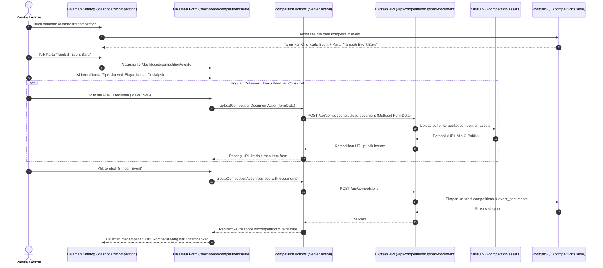

# Spesifikasi Fitur: Manajemen Kompetisi & Event (Competition Management)

Dokumen ini mendefinisikan rancangan teknis, skema database, aturan validasi, arsitektur Domain-Driven Design (DDD), serta alur antarmuka modul **Manajemen Kompetisi & Event** untuk platform **Kemas Prasasti 2025**.

---

## 1. Latar Belakang & Tujuan

Modul Manajemen Kompetisi & Event adalah modul inti pada Admin Dashboard yang memfasilitasi panitia dalam mengatur seluruh cabang kompetisi dan agenda event yang diselenggarakan pada Kemas Prasasti 2025. 

Tujuan utama:
1. Menyediakan antarmuka terpusat bagi panitia untuk mengelola kompetisi (Create, Read, Update, Delete).
2. Mendukung klasifikasi tipe kegiatan antara **Turnamen (*Tournament*)** dan **Acara (*Event*)**.
3. Mengatur jadwal krusial: periode buka pendaftaran, penutupan pendaftaran, serta tanggal pelaksanaan acara.
4. Menetapkan skema biaya pendaftaran (gratis atau nominal biaya dalam Rupiah).

---

## 2. Struktur Input & Kebutuhan Data

Sesuai kebutuhan sistem, setiap entitas kompetisi memiliki atribut input berikut:

| Field Input | Tipe Data | Keterangan | Validasi Zod |
| :--- | :--- | :--- | :--- |
| **`name`** (Nama) | String | Nama kompetisi atau nama event (misal: "Futsal Cup 2025", "Mobile Legends Tournament", "National Try Out") | Min. 3 karakter, Maks. 200 karakter |
| **`type`** (Tipe) | Enum | Klasifikasi jenis agenda: `'TOURNAMENT'` atau `'EVENT'` | Wajib dipilih (`TOURNAMENT` / `EVENT`) |
| **`registrationStartDate`** (Tgl Buka Pendaftaran) | Timestamp (Date) | Tanggal dan jam registrasi peserta mulai dibuka | Wajib diisi format tanggal valid |
| **`registrationEndDate`** (Tgl Tutup Pendaftaran) | Timestamp (Date) | Batas akhir waktu registrasi peserta ditutup (*close register*) | Wajib $\ge$ `registrationStartDate` |
| **`eventStartDate`** (Tgl Dimulai Acara) | Timestamp (Date) | Hari dan jam pelaksanaan acara/lomba dimulai | Wajib diisi format tanggal valid |
| **`eventEndDate`** (Tgl Selesai Acara / Tanggal) | Timestamp (Date) | Hari dan jam pelaksanaan acara/lomba selesai | Wajib $\ge$ `eventStartDate` |
| **`priceList`** (Daftar Harga / Price List) | JSONB Array | Daftar tingkatan harga kompetisi (misal: Normal Price, Presale 1, Early Bird). Default: `[{ id: 'default', name: 'Normal Price', price: 0 }]` | Minimal 1 item valid |
| **`selectedPriceId`** (Tier Harga Aktif) | String | ID dari tier price list yang sedang aktif dan diterapkan untuk event ini | Wajib mengacu ke salah satu item di `priceList` |
| **`fee`** (Biaya Aktif) | Integer / Number | Biaya registrasi aktif dalam Rupiah (Rp) yang disinkronkan otomatis dari tier terpilih (`selectedPriceId`). Nilai `0` berarti gratis (*Free Entry*). Input manual biaya aktif dihilangkan dari form karena langsung terikat pada tier harga. | Min. 0 |
| **`contactPersonIds`** (Contact Person) | Array UUID (Opsional) | Daftar ID narahubung panitia yang ditugaskan untuk kompetisi ini (Relasi Many-to-Many). Dipilih via dropdown dan bisa ditambah inline. | Opsional |
| **`guidebookUrl`** (Buku Panduan / Rulebook PDF) | Text / URL (Opsional) | URL relatif publik berkas PDF panduan teknis/juknis lomba yang disimpan di direktori `public/documents/guidebooks/` dengan penamaan random UUID (Maks. 2MB, MIME: `application/pdf`). Bernilai `null` jika tidak diunggah. | Nullable / Optional valid path string |
| **`description`** (Deskripsi) | Text (Opsional) | Ringkasan informasi, syarat singkat, atau format perlombaan | Opsional |
| **`maxQuota`** (Batas Kuota) | Integer (Opsional) | Maksimal kuota tim/peserta yang diterima (jika dibatasi) | Min. 1 jika diisi |
| **`status`** (Status Pendaftaran) | Enum | Status operasional registrasi: `OPEN`, `CLOSED`, `UPCOMING`, `COMPLETED` | Default: `OPEN` |

---

## 2.1 Alur Pembuatan Cepat via Modal (Quick Create Flow)

Untuk mempermudah dan mempercepat penambahan cabang lomba/event baru tanpa harus mengisi puluhan input di awal:
1. **Modal Interaktif (`CreateCompetitionDialog`):**
   - Muncul saat tombol **"Tambah Kompetisi"** pada toolbar atau kartu **"Tambah Event Baru"** pada grid ditekan.
   - Menggunakan komponen resmi Shadcn UI Dialog.
2. **Input Sederhana:**
   - **`name`**: Nama kompetisi / event (min. 3 karakter).
   - **`type`**: Tipe kegiatan (`TOURNAMENT` atau `EVENT`).
   - **Pilihan Komponen Otomatis (Checkbox):**
     - `createRegistrationForm` (Default: Aktif): Membuat draft formulir pendaftaran dinamis kosong dan otomatis memasangnya sebagai formulir aktif.
     - `createRundown` (Default: Aktif): Membuat draft susunan acara (`competition_rundowns`) dengan isian agenda kosong.
     - `createBracket` (Default: Aktif untuk Tournament): Menyiapkan draft bagan pertandingan (`competition_brackets`) kosong.
3. **Hasil Submit:**
   - Menyimpan event ke database PostgreSQL via endpoint `POST /api/competitions/quick-create` / Server Action `quickCreateCompetitionAction`.
   - Menampilkan notifikasi Sonner Toast di posisi `top-right`.
   - Mengarahkan panitia langsung ke halaman edit detail event (`/dashboard/competition/[id]/edit`) agar dapat melengkapi dokumen, deskripsi, narahubung, dan jadwal waktu secara bertahap.

---

Skema tabel didefinisikan secara deklaratif di `modules/competition/infrastructure/competition.table.ts`:

```typescript
import { pgTable, uuid, varchar, text, integer, timestamp, pgEnum, jsonb } from "drizzle-orm/pg-core";

export const competitionTypeEnum = pgEnum("competition_type", [
  "EVENT",
  "TOURNAMENT",
]);

export const competitionStatusEnum = pgEnum("competition_status", [
  "UPCOMING",
  "OPEN",
  "CLOSED",
  "COMPLETED",
]);

export interface PriceListItem {
  id: string;
  name: string;
  price: number;
}

export const competitionsTable = pgTable("competitions", {
  id: uuid("id").defaultRandom().primaryKey(),
  name: varchar("name", { length: 200 }).notNull(),
  type: competitionTypeEnum("type").default("TOURNAMENT").notNull(),
  registrationStartDate: timestamp("registration_start_date", { withTimezone: true }).notNull(),
  registrationEndDate: timestamp("registration_end_date", { withTimezone: true }).notNull(),
  eventStartDate: timestamp("event_start_date", { withTimezone: true }).notNull(),
  eventEndDate: timestamp("event_end_date", { withTimezone: true }).notNull(),
  fee: integer("fee").default(0).notNull(), // Biaya aktif tersinkron dari tier terpilih
  priceList: jsonb("price_list")
    .$type<PriceListItem[]>()
    .default([{ id: "default", name: "Normal Price", price: 0 }])
    .notNull(),
  selectedPriceId: varchar("selected_price_id", { length: 50 })
    .default("default")
    .notNull(),
  guidebookUrl: text("guidebook_url"), // Nullable: URL publik PDF rulebook di folder public (Maks. 2MB)
  description: text("description"),
  maxQuota: integer("max_quota"),
  status: competitionStatusEnum("status").default("OPEN").notNull(),
  createdAt: timestamp("created_at", { withTimezone: true }).defaultNow().notNull(),
  updatedAt: timestamp("updated_at", { withTimezone: true })
    .defaultNow()
    .$onUpdate(() => new Date())
    .notNull(),
});

export const contactPersonsTable = pgTable("contact_persons", {
  id: uuid("id").defaultRandom().primaryKey(),
  name: varchar("name", { length: 150 }).notNull(),
  phone: varchar("phone", { length: 30 }).notNull(),
  createdAt: timestamp("created_at", { withTimezone: true }).defaultNow().notNull(),
  updatedAt: timestamp("updated_at", { withTimezone: true })
    .defaultNow()
    .$onUpdate(() => new Date())
    .notNull(),
});

// Relasi Many-to-Many: 1 CP punya banyak kompetisi, 1 kompetisi punya banyak CP
export const competitionContactPersonsTable = pgTable(
  "competition_contact_persons",
  {
    competitionId: uuid("competition_id")
      .notNull()
      .references(() => competitionsTable.id, { onDelete: "cascade" }),
    contactPersonId: uuid("contact_person_id")
      .notNull()
      .references(() => contactPersonsTable.id, { onDelete: "cascade" }),
    createdAt: timestamp("created_at", { withTimezone: true }).defaultNow().notNull(),
  },
  (table) => [
    primaryKey({ columns: [table.competitionId, table.contactPersonId] }),
  ]
);

// Relasi 1:N: 1 Kompetisi memiliki banyak Dokumen/Berkas (event_documents)
export const eventDocumentsTable = pgTable("event_documents", {
  id: uuid("id").defaultRandom().primaryKey(),
  competitionId: uuid("competition_id")
    .notNull()
    .references(() => competitionsTable.id, { onDelete: "cascade" }),
  name: varchar("name", { length: 255 }).notNull(),
  filePath: text("file_path").notNull(),
  createdAt: timestamp("created_at", { withTimezone: true }).defaultNow().notNull(),
  updatedAt: timestamp("updated_at", { withTimezone: true })
    .defaultNow()
    .$onUpdate(() => new Date())
    .notNull(),
});
```

---

## 4. Tampilan Kartu Kompetisi (Nama Price List & Harga Langsung)

Pada kartu kompetisi (`CompetitionCard`):
1. **Penyajian Harga Langsung:** Menampilkan nama price list aktif dan harga nominalnya secara langsung (contoh: `Normal Price: Free Entry` atau `Presale 1: Rp 35.000`), sehingga panitia langsung melihat tier yang sedang berlaku tanpa perlu membuka menu edit.
2. **Badge Tier Aktif:** Badge tier harga diletakkan tegas di samping status kompetisi.

---

## 5. Price List Selector (Terintegrasi Penuh)

Sistem presale terintegrasi langsung ke dalam Form Kompetisi (*Add/Edit Event*) melalui komponen **Price List Selector Dropdown**:
1. **Default State:** Setiap pembuatan event baru secara otomatis memiliki tier default `Normal Price = Rp 0` dengan ID `default`.
2. **Dropdown Interaktif:**
   - Memilih tier harga aktif: Memilih tier pada dropdown langsung mengubah nilai `selectedPriceId` dan nominal `fee` secara otomatis.
   - Menambahkan tier baru: Terdapat form inline di dalam dropdown untuk memasukkan nama tier (misal: "Presale 1") dan nominal harga (misal: 30000).
   - Mengedit & Menghapus tier: Langsung dari dalam dropdown selector.
3. **Peniadaan Input Terpisah:** Input "Nominal Biaya Aktif" dihapus dari form karena nominal biaya secara otomatis selalu mengikuti harga dari tier price list yang sedang terpilih.

---

## 6. Fitur Manajemen Contact Person (Sub-Menu & Dropdown Selector)

Narahubung panitia dikelola secara terpusat dengan relasi **Many-to-Many ($M:N$)**:
1. **Halaman Sub-Kompetisi (`/dashboard/competition/contact-person`):**
   - Halaman khusus pada sub-menu Events di sidebar dashboard untuk mengelola seluruh data narahubung panitia.
   - Kolom data: **Nama Lengkap**, **Nomor WhatsApp / HP**, **Daftar Kompetisi Terkait**, serta aksi Edit dan Hapus.
   - Modal Dialog Tambah & Edit Contact Person.
2. **Komponen `ContactPersonSelector` pada Form Kompetisi:**
   - Berupa Dropdown / Popover interaktif (mirip dengan `PriceListSelector`).
   - Panitia dapat memilih 1 atau lebih contact person yang sudah ada di database untuk dikaitkan dengan kompetisi.
   - Menyediakan form penambahan contact person baru secara inline (input Nama & Nomor HP) langsung di dalam dropdown tanpa harus keluar dari halaman formulir kompetisi.
   - Saat disimpan, relasi M:N disinkronkan otomatis pada tabel `competition_contact_persons`.

---

## 7. Fitur Unggah Berkas & Buku Panduan ke MinIO Object Storage

Seluruh berkas dokumen kompetisi dan **Buku Panduan / Rulebook (PDF)** disimpan secara terpusat pada **MinIO Object Storage** (S3-Compatible) di bucket `competition-assets` dengan akses publik (*Public Read*):
1. **Penyimpanan & Bucket MinIO:**
   - **Bucket:** `competition-assets` (Public Read Policy: `s3:GetObject`).
   - **Subdirektori:** `documents/` (berkas umum, formulir, surat pernyataan) dan `guidebooks/` (rulebook/juknis).
   - **Akses Publik:** URL MinIO: `http://localhost:9000/competition-assets/documents/{filename}.pdf` (atau domain production S3).
   - **Generasi Nama Unik:** Menggunakan timestamp dan token acak (`Date.now()_UUID`) untuk mencegah tabrakan nama berkas.
   - **Format yang Diizinkan:** Berkas PDF, Word (.docx, .doc), serta berkas gambar (.png, .jpg).
2. **Alur Interaksi Upload & Validasi:**
   - **Komponen Input File (Shadcn UI & Drag-Drop):** Area upload intuitif dengan badge status MinIO S3, preview nama berkas, ukuran, dan format.
   - **Validasi Klien & Server:**
     - Validasi ukuran berkas (Maks. 2MB per berkas).
     - Validasi tipe MIME dan ekstensi berkas.
   - **Pembersihan Berkas Fisik:**
     - Saat berkas diganti atau dihapus, backend use case secara otomatis menghapus objek fisik dari MinIO via `deleteEventDocumentFromMinio()`.

---

## 8. Alur Pengguna (User Flow)



---

## 9. Arsitektur Domain-Driven Design (DDD) untuk Bounded Context `competition`

```text
modules/competition/
├── domain/
│   ├── competition-type.enum.ts      # Enum: EVENT, TOURNAMENT
│   ├── competition-status.enum.ts    # Enum: UPCOMING, OPEN, CLOSED, ONGOING, COMPLETED
│   ├── competition.entity.ts         # Tipe entitas Competition
│   └── competition.schema.ts         # Zod validation schema (competitionFormSchema dengan guidebookUrl)
├── application/
│   ├── competition.actions.ts        # Server Actions: create, update, delete, toggleStatus
│   ├── contact-person.actions.ts     # Server Actions: CRUD contact person
│   └── competition-upload.action.ts  # Server Action: upload & delete PDF guidebook di folder public/
├── infrastructure/
│   ├── competition.table.ts          # Skema Drizzle ORM PostgreSQL (kolom guidebook_url nullable)
│   ├── competition.repository.ts     # Data access queries
│   ├── contact-person.table.ts       # Skema tabel contact person & pivot relation
│   ├── contact-person.repository.ts  # Repository contact person
│   └── competition-file.helper.ts    # Helper penulisan & penghapusan berkas fisik di public/documents/guidebooks/
└── presentation/
    └── components/
        ├── competition-card.tsx      # Komponen kartu detail (dilengkapi badge/link download PDF jika ada)
        ├── add-competition-card.tsx  # Kartu khusus "Tambah Event Baru" (mengarah ke /create)
        ├── competition-form.tsx      # Form pembuatan & pengeditan kompetisi (Shadcn UI + PDF uploader)
        ├── competition-guidebook-uploader.tsx # Komponen uploader file PDF dengan preview & validasi 2MB
        ├── price-list-selector.tsx   # Dropdown selector & manager price list tier
        ├── contact-person-selector.tsx # Dropdown selector & inline creator contact person
        ├── competition-grid.tsx      # Grid tampilan kartu kompetisi dengan pencarian & filter
        └── competition-stats.tsx     # Kartu metrik (Total, Tournament, Event, Pendaftaran Terbuka)
```

---

## 10. Desain Antarmuka Dashboard

Antarmuka dibangun **100% menggunakan primitif Shadcn UI**:
1. **Halaman Katalog (`/dashboard/competition`):**
   - **Kartu Metrik Ringkasan:** Total Kompetisi, Total Turnamen, Total Event, Pendaftaran Terbuka.
   - **Filter & Search Bar:** Filter tipe (`Semua`, `Tournament`, `Event`), status (`Semua`, `Buka`, `Tutup`), dan pencarian teks.
   - **Grid Kartu Kompetisi:**
     - **Kartu Pertama:** `AddCompetitionCard` (kartu bergaris putus-putus elegan dengan ikon Plus bertuliskan *"Tambah Kompetisi / Event Baru"* yang langsung mengarahkan ke `/dashboard/competition/create`).
     - **Kartu Kompetisi:** Menampilkan Badge Tipe, Badge Status, Nama Lomba, Biaya Registrasi (Rp), Jadwal Registrasi, Jadwal Pelaksanaan Acara, Kuota, Deskripsi singkat, Badge Buku Panduan PDF (jika ada, link preview), tombol Edit (`/dashboard/competition/[id]/edit`), tombol Toggle Buka/Tutup Pendaftaran, dan tombol Hapus.
2. **Halaman Formulir (`/dashboard/competition/create` & `/dashboard/competition/[id]/edit`):**
   - Menggunakan komponen Shadcn UI (`Card`, `Input`, `Label`, `Select`, `Textarea`, `Button`).
   - Tombol "Kembali ke Katalog".
   - Field yang rapi, responsif, dan validasi Zod error inline.
   - **Section Buku Panduan / Rulebook (PDF):** Area unggah berkas PDF dengan batas maksimal 2MB, progress/status upload, nama berkas, tombol unduh untuk melihat dokumen, serta tombol ganti/hapus.
   - Tombol "Simpan Kompetisi" dengan loading spinner yang otomatis redirect ke `/dashboard/competition` ketika berhasil disimpan.

---

## 11. Proteksi Controller & Keamanan Akses

- **Middleware Route Protection:** Rute `/dashboard/competition` diproteksi secara otomatis oleh `middleware.ts`.
- **Server Action Controller Protection:** Seluruh mutasi data (`createCompetitionAction`, `updateCompetitionAction`, `deleteCompetitionAction`, `toggleCompetitionStatusAction`, `uploadCompetitionGuidebookAction`) memanggil `await requireAuthUser()` untuk memastikan request berasal dari admin yang sah.

---

## 12. Status & Tahapan Pekerjaan

- [x] **Tahap 1: Analisis Kebutuhan & Dokumen Perencanaan** (Dokumen `docs/feateures/competition-feature.md` selesai dirancang)
- [x] **Tahap 2: Konfirmasi & Persetujuan Pengguna** (Disetujui: Add Event Card, Halaman Form `/create` & `/[id]/edit`, input lengkap nama, tipe, jadwal registrasi & acara, biaya, kuota, deskripsi)
- [x] **Tahap 3: Implementasi Lapisan Domain & Skema Validasi** (`competition-type.enum.ts`, `competition-status.enum.ts`, `competition.schema.ts`)
- [x] **Tahap 4: Implementasi Lapisan Infrastruktur & Migrasi Database** (`competition.table.ts`, `competition.repository.ts`, migrasi `0005_lively_black_bird.sql` & `0007_mushy_kate_bishop.sql`)
- [x] **Tahap 5: Implementasi Lapisan Application & Server Actions** (`competition.actions.ts` dengan guard autentikasi `requireAuthUser`)
- [x] **Tahap 6: Implementasi Lapisan Presentation & UI Dashboard** (`add-competition-card.tsx`, `competition-card.tsx`, `competition-grid.tsx`, `competition-stats.tsx`, `competition-form.tsx`, halaman `/dashboard/competition`, `/create`, `/[id]/edit`)
- [x] **Tahap 7: Update Fitur Input File PDF Buku Panduan / Rulebook (Folder Public & Random URL):**
  - [x] Penyiapan direktori `public/documents/guidebooks/`.
  - [x] Penambahan kolom `guidebook_url` (text, nullable) di `competitionsTable` & migrasi Drizzle (`0009_icy_tombstone.sql`).
  - [x] Update validasi Zod di `competition.schema.ts` (`guidebookUrl`).
  - [x] Pembuatan Server Action & Helper upload/delete file PDF dengan generate random UUID name (`competition-file.helper.ts`, `competition-upload.action.ts`).
  - [x] Integrasi komponen upload PDF di `CompetitionForm` (`competition-guidebook-uploader.tsx`) dan penanda link rulebook di `CompetitionCard`.
- [x] **Tahap 8: Verifikasi & Pengujian Fungsional Menyeluruh** (Build & lint clean, uji upload PDF, validasi ukuran > 2MB, update & hapus file PDF)
- [x] **Tahap 9: Tabel Rundown, Tabel Bracket, dan Section Additional Event:**
  - [x] Pembuatan data table interaktif Rundown (`/dashboard/competition/rundown`) dan Bracket (`/dashboard/competition/bracket`).
  - [x] Dialog modal cepat edit Rundown (`RundownEditDialog`) dan edit Bracket (`BracketEditDialog`).
  - [x] Refactoring Form Edit (`CompetitionForm`) dengan field group baru bertajuk **"Additional Event"**.
  - [x] Integrasi tombol Tambah Additional dinamis (dropdown), Edit komponen, dan Hapus komponen berperingatan AlertDialog.
  - [x] Pemindahan switch *"Tanpa Pendaftaran (No Registration Needed)"* ke dalam section Additional Event.

---

## 13. Manajemen Rundown & Bracket

Tersedia halaman monitoring dan pengelolaan khusus untuk susunan acara dan bagan turnamen:
1. **Halaman Rundown (`/dashboard/competition/rundown`):**
   - Menampilkan seluruh susunan agenda kegiatan dari semua event dalam bentuk tabel interaktif.
   - Kolom: Nama Event & Badge Tipe, Judul Rundown, Jumlah Sesi/Agenda, Periode Pelaksanaan, Terakhir Diperbarui, dan Aksi (Edit dialog & Hapus).
   - Dilengkapi filter pencarian realtime.
2. **Halaman Bracket Card Grid (`/dashboard/competition/bracket`):**
   - Menampilkan seluruh bagan turnamen sistem gugur/round-robin menggunakan **Card Grid interaktif** (bukan tabel kaku), memberikan tampilan visual modern yang informatif.
   - Setiap kartu menyajikan:
     - Badge format turnamen (Single Elimination, Double Elimination, Round Robin, Swiss).
     - Nama turnamen/kompetisi dan judul bagan.
     - Status bagan: *Bagan Aktif & Berjalan* (dengan progress bar pertandingan selesai) atau *Bagan Belum Diundi*.
     - Tautan langsung ke live Challonge jika terhubung.
     - **Tombol "View":** Mengarahkan panitia langsung ke **Halaman Dedicated Bagan Pertandingan** (`/dashboard/competition/bracket/[id]`), menyajikan visualisasi pohon turnamen interaktif yang luas (bukan modal pop-up), dilengkapi dengan:
       - **Statistik Cepat Turnamen:** Total peserta/tim terdaftar, jumlah babak, rasio pertandingan selesai/belum, dan highlight tim Juara Turnamen.
       - **Kontrol Kanvas Interaktif:** Zoom In, Zoom Out, Reset 100%, dan tombol Layar Penuh (*Fullscreen*).
       - **Tombol Aksi Kelola:** Akses langsung ke modal pengelolaan skor pertandingan dan seeding bagan tanpa perlu kembali ke halaman daftar.
       - **Tautan Live Eksternal:** Akses cepat ke bagan live Challonge di tab baru jika telah dikonfigurasi.
     - **Tombol "Edit":** Membuka modal dialog manajemen turnamen dengan 3 tab:
       - **Tab Drawing & Seeding:** Mengambil seluruh data peserta berstatus `VERIFIED` dari kompetisi tersebut (`GET /api/competitions/:id/verified-participants`), menyediakan checklist peserta, tombol acak (shuffle) seed, dan generator bagan turnamen otomatis.
       - **Tab Live Match & Skor:** Mengelola hasil pertandingan tiap babak (Babak 1, Perempat Final, Semi Final, Grand Final), input skor angka, validasi tanpa seri, serta otomatis meloloskan tim pemenang ke babak selanjutnya.
       - **Tab Info & Challonge:** Mengatur judul bagan, format gugur, dan tautan live stream/Challonge eksternal.
     - **Tombol Hapus:** Menghapus bagan pertandingan dengan konfirmasi peringatan `AlertDialog`.


---

## 14. Section Form: "Additional Event"

Pada halaman edit kompetisi (`/dashboard/competition/[id]/edit`), seluruh komponen tambahan dikelompokkan ke dalam satu kartu terpadu bertajuk **"Additional Event"**:
1. **Switch Tanpa Pendaftaran (No Registration Needed):**
   - Mengontrol apakah event memerlukan proses pendaftaran formulir atau bersifat acara bebas terbuka.
2. **Daftar Additional Aktif:**
   - **Formulir Pendaftaran:** Menampilkan status aktif, tombol *"Edit Formulir"* (menuju form builder dinamis), dan tombol nonaktifkan/hapus.
   - **Susunan Acara (Rundown):** Menampilkan judul rundown, jumlah agenda sesi yang terdaftar, tombol *"Edit Rundown"* (membuka modal dialog agenda), dan tombol hapus.
   - **Bagan Pertandingan (Bracket):** Menampilkan judul bagan, format pertandingan, status link Challonge, tombol *"Edit Bracket"* (membuka modal dialog bracket), dan tombol hapus.
3. **Dropdown "Tambah Additional":**
   - Memungkinkan panitia mengaktifkan komponen additional yang belum ada (Formulir Pendaftaran, Rundown, atau Bracket) secara instan langsung dari halaman edit.

---

## 15. Integrasi Halaman Publik: Landing, Detail, dan Registrasi Peserta (Database-Driven)

Seluruh halaman publik kompetisi telah terhubung 100% secara langsung ke database PostgreSQL melalui RESTful API backend (`be-app`) menggunakan standar komponen **Shadcn UI** yang fungsional, bersih, dan aksesibel:

1. **Halaman Katalog Kompetisi (`/competition`):**
   - **Path File:** `app/(landing)/competition/page.tsx`
   - **Data Fetching:** Memanggil `getAllCompetitions()` dari `competition.repository.ts` (`GET /api/competitions`) secara dinamis (`force-dynamic`).
   - **Komponen UI (Shadcn):**
     - `HeroSection.tsx`: Menampilkan badge dinamis total kompetisi aktif dan judul resmi PRASASTI 2026.
     - `EventCard.tsx`: Kartu standar Shadcn UI (`Card`, `CardHeader`, `CardTitle`, `CardDescription`, `CardContent`, `CardFooter`, `Badge`, `Button`).
     - **Informasi Kartu:** Badge tipe (`TOURNAMENT`/`EVENT`), Badge status pendaftaran (`Pendaftaran Dibuka` / `Pendaftaran Ditutup`), periode pendaftaran, tanggal pelaksanaan, rincian biaya / paket tarif, kuota maksimal peserta, dan jumlah dokumen juknis yang tersedia.
     - **Aksi Cepat:** Tombol *"Lihat Detail"* (mengarahkan ke `/competition/[id]`) dan *"Daftar Sekarang"* (mengarahkan langsung ke formulir pendaftaran `/competition/[id]/register`).

2. **Halaman Detail Kompetisi (`/competition/[id]`):**
   - **Path File:** `app/(detail)/competition/[id]/page.tsx`
   - **Data Fetching:** Memanggil `getCompetitionById(id)` dari `competition.repository.ts` (`GET /api/competitions/:id`).
   - **Komponen UI (Shadcn):**
     - **Top Bar:** Tombol kembali *"Kembali ke Daftar Kompetisi"* beserta badge status dan tipe.
     - **Header Hero Card:** Judul kompetisi, deskripsi lengkap, serta highlight biaya registrasi.
     - **Grid 2 Kolom:**
       - **Jadwal & Waktu Pelaksanaan:** Kartu ringkasan tanggal buka/tutup registrasi dan rentang hari acara.
       - **Biaya & Paket Registrasi:** Tabel interaktif Shadcn UI yang menyajikan seluruh tier harga (`priceList`) beserta penanda tier aktif.
       - **Buku Panduan & Dokumen Resmi:** Daftar seluruh dokumen panduan/juknis lomba dengan tombol *"Unduh"* langsung ke berkas terkait.
       - **Susunan Acara (Rundown):** Tabel jadwal kegiatan (Waktu, Agenda, Lokasi/Keterangan) jika event memiliki rundown aktif.
       - **Bagan Pertandingan (Bracket):** Informasi tipe format turnamen dan tautan bagan Challonge eksternal jika dikonfigurasi.
       - **Sidebar Pendaftaran:** Status pembukaan, kuota tersisa, dan tombol utama *"Daftar Sekarang (Formulir Online)"* menuju formulir pendaftaran.
       - **Sidebar Narahubung:** Kontak panitia penanggung jawab dengan tombol pintasan chat WhatsApp langsung.

3. **Halaman Registrasi Peserta (`/competition/[id]/register` & `/register/[competitionId]`):**
   - **Path File:** `app/(detail)/competition/[id]/register/page.tsx` dan `app/(landing)/register/[competitionId]/page.tsx`.
   - **Alur Pendaftaran:** Mengambil skema formulir aktif dari database (`GET /api/competitions/:id/form/active-or-create`) dan merender komponen `DynamicFormRenderer`.
   - **Proteksi & Validasi:** Dilengkapi validasi client-side, pencegahan pendaftaran ganda via email, proteksi anti-spam rate limiter, serta penerbitan nomor unik registrasi pendaftar.
   - **Relay Redirect:** URL ramah `/register/[competitionId]` secara otomatis meneruskan (*HTTP 307 temporary redirect*) peserta ke rute kanonikal `/competition/[id]/register`.

