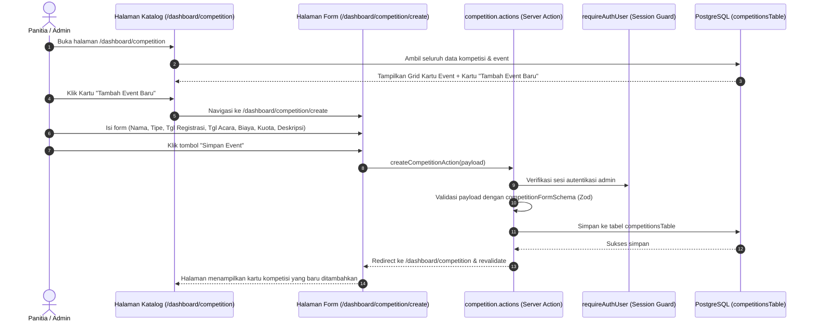

# Spesifikasi Fitur: Manajemen Kompetisi & Event (Competition Management)

Dokumen ini mendefinisikan rancangan teknis, skema database, aturan validasi, arsitektur Domain-Driven Design (DDD), serta alur antarmuka modul **Manajemen Kompetisi & Event** untuk platform **Kemas Prasasti 2025**.

---

## 1. Latar Belakang & Tujuan

Modul Manajemen Kompetisi & Event adalah modul inti pada Admin Dashboard yang memfasilitasi panitia dalam mengatur seluruh cabang kompetisi dan agenda event yang diselenggarakan pada Kemas Prasasti 2025. 

Tujuan utama:
1. Menyediakan antarmuka terpusat bagi panitia untuk mengelola kompetisi (Create, Read, Update, Delete).
2. Mendukung klasifikasi tipe kegiatan antara **Turnamen (*Tournament*)** dan **Acara (*Event*)**.
3. Mengatur jadwal krusial: periode buka pendaftaran, penutupan pendaftaran, serta tanggal pelaksanaan acara.
4. Menetapkan skema biaya pendaftaran (gratis atau nominal biaya dalam Rupiah).

---

## 2. Struktur Input & Kebutuhan Data

Sesuai kebutuhan sistem, setiap entitas kompetisi memiliki atribut input berikut:

| Field Input | Tipe Data | Keterangan | Validasi Zod |
| :--- | :--- | :--- | :--- |
| **`name`** (Nama) | String | Nama kompetisi atau nama event (misal: "Futsal Cup 2025", "Mobile Legends Tournament", "National Try Out") | Min. 3 karakter, Maks. 200 karakter |
| **`type`** (Tipe) | Enum | Klasifikasi jenis agenda: `'TOURNAMENT'` atau `'EVENT'` | Wajib dipilih (`TOURNAMENT` / `EVENT`) |
| **`registrationStartDate`** (Tgl Buka Pendaftaran) | Timestamp (Date) | Tanggal dan jam registrasi peserta mulai dibuka | Wajib diisi format tanggal valid |
| **`registrationEndDate`** (Tgl Tutup Pendaftaran) | Timestamp (Date) | Batas akhir waktu registrasi peserta ditutup (*close register*) | Wajib $\ge$ `registrationStartDate` |
| **`eventStartDate`** (Tgl Dimulai Acara) | Timestamp (Date) | Hari dan jam pelaksanaan acara/lomba dimulai | Wajib diisi format tanggal valid |
| **`eventEndDate`** (Tgl Selesai Acara / Tanggal) | Timestamp (Date) | Hari dan jam pelaksanaan acara/lomba selesai | Wajib $\ge$ `eventStartDate` |
| **`fee`** (Biaya) | Integer / Number | Biaya registrasi dalam Rupiah (Rp). Nilai `0` berarti gratis (*Free Entry*) | Min. 0 (tidak boleh negatif) |
| **`description`** (Deskripsi) | Text (Opsional) | Ringkasan informasi, syarat singkat, atau format perlombaan | Opsional |
| **`maxQuota`** (Batas Kuota) | Integer (Opsional) | Maksimal kuota tim/peserta yang diterima (jika dibatasi) | Min. 1 jika diisi |
| **`status`** (Status Pendaftaran) | Enum | Status operasional registrasi: `OPEN`, `CLOSED`, `ONGOING`, `COMPLETED` | Default: `OPEN` |

---

## 3. Skema Database PostgreSQL & Drizzle ORM

Skema tabel didefinisikan secara deklaratif di `modules/competition/infrastructure/competition.table.ts`:

```typescript
import { pgTable, uuid, varchar, text, integer, timestamp, pgEnum } from "drizzle-orm/pg-core";

export const competitionTypeEnum = pgEnum("competition_type", [
  "EVENT",
  "TOURNAMENT",
]);

export const competitionStatusEnum = pgEnum("competition_status", [
  "UPCOMING",
  "OPEN",
  "CLOSED",
  "ONGOING",
  "COMPLETED",
]);

export const competitionsTable = pgTable("competitions", {
  id: uuid("id").defaultRandom().primaryKey(),
  name: varchar("name", { length: 200 }).notNull(),
  type: competitionTypeEnum("type").default("TOURNAMENT").notNull(),
  registrationStartDate: timestamp("registration_start_date", { withTimezone: true }).notNull(),
  registrationEndDate: timestamp("registration_end_date", { withTimezone: true }).notNull(),
  eventStartDate: timestamp("event_start_date", { withTimezone: true }).notNull(),
  eventEndDate: timestamp("event_end_date", { withTimezone: true }).notNull(),
  fee: integer("fee").default(0).notNull(), // 0 = Free Entry
  description: text("description"),
  maxQuota: integer("max_quota"),
  status: competitionStatusEnum("status").default("OPEN").notNull(),
  hasPresale: boolean("has_presale").default(false).notNull(),
  createdAt: timestamp("created_at", { withTimezone: true }).defaultNow().notNull(),
  updatedAt: timestamp("updated_at", { withTimezone: true })
    .defaultNow()
    .$onUpdate(() => new Date())
    .notNull(),
});

export const competitionPresalesTable = pgTable("competition_presales", {
  id: uuid("id").defaultRandom().primaryKey(),
  competitionId: uuid("competition_id")
    .notNull()
    .references(() => competitionsTable.id, { onDelete: "cascade" }),
  name: varchar("name", { length: 150 }).notNull(),
  price: integer("price").notNull(),
  startDate: timestamp("start_date", { withTimezone: true }).notNull(),
  endDate: timestamp("end_date", { withTimezone: true }).notNull(),
  quota: integer("quota"),
  isActive: boolean("is_active").default(true).notNull(),
  createdAt: timestamp("created_at", { withTimezone: true }).defaultNow().notNull(),
  updatedAt: timestamp("updated_at", { withTimezone: true })
    .defaultNow()
    .$onUpdate(() => new Date())
    .notNull(),
});

export type CompetitionSelect = typeof competitionsTable.$inferSelect;
export type CompetitionInsert = typeof competitionsTable.$inferInsert;
export type CompetitionPresaleSelect = typeof competitionPresalesTable.$inferSelect;
export type CompetitionPresaleInsert = typeof competitionPresalesTable.$inferInsert;
```

---

## 4. Alur Pengguna (User Flow)



---

## 5. Arsitektur Domain-Driven Design (DDD) untuk Bounded Context `competition`

```text
modules/competition/
├── domain/
│   ├── competition-type.enum.ts      # Enum: EVENT, TOURNAMENT
│   ├── competition-status.enum.ts    # Enum: UPCOMING, OPEN, CLOSED, ONGOING, COMPLETED
│   ├── competition.entity.ts         # Tipe entitas Competition
│   └── competition.schema.ts         # Zod validation schema (competitionFormSchema)
├── application/
│   └── competition.actions.ts        # Server Actions: create, update, delete, toggleStatus
├── infrastructure/
│   ├── competition.table.ts          # Skema Drizzle ORM PostgreSQL
│   └── competition.repository.ts     # Data access queries (getAll, getById, create, update, delete)
└── presentation/
    └── components/
        ├── competition-card.tsx      # Komponen kartu detail kompetisi/event
        ├── add-competition-card.tsx  # Kartu khusus "Tambah Event Baru" (mengarah ke /create)
        ├── competition-form.tsx      # Form pembuatan & pengeditan kompetisi (Shadcn UI)
        ├── competition-grid.tsx      # Grid tampilan kartu kompetisi dengan pencarian & filter
        └── competition-stats.tsx     # Kartu metrik (Total, Tournament, Event, Pendaftaran Terbuka)
```

---

## 6. Desain Antarmuka Dashboard

Antarmuka dibangun **100% menggunakan primitif Shadcn UI**:
1. **Halaman Katalog (`/dashboard/competition`):**
   - **Kartu Metrik Ringkasan:** Total Kompetisi, Total Turnamen, Total Event, Pendaftaran Terbuka.
   - **Filter & Search Bar:** Filter tipe (`Semua`, `Tournament`, `Event`), status (`Semua`, `Buka`, `Tutup`), dan pencarian teks.
   - **Grid Kartu Kompetisi:**
     - **Kartu Pertama:** `AddCompetitionCard` (kartu bergaris putus-putus elegan dengan ikon Plus bertuliskan *"Tambah Kompetisi / Event Baru"* yang langsung mengarahkan ke `/dashboard/competition/create`).
     - **Kartu Kompetisi:** Menampilkan Badge Tipe, Badge Status, Nama Lomba, Biaya Registrasi (Rp), Jadwal Registrasi, Jadwal Pelaksanaan Acara, Kuota, Deskripsi singkat, tombol Edit (`/dashboard/competition/[id]/edit`), tombol Toggle Buka/Tutup Pendaftaran, dan tombol Hapus.
2. **Halaman Formulir (`/dashboard/competition/create` & `/dashboard/competition/[id]/edit`):**
   - Menggunakan komponen Shadcn UI (`Card`, `Input`, `Label`, `Select`, `Textarea`, `Button`).
   - Tombol "Kembali ke Katalog".
   - Field yang rapi, responsif, dan validasi Zod error inline.
   - Tombol "Simpan Kompetisi" dengan loading spinner yang otomatis redirect ke `/dashboard/competition` ketika berhasil disimpan.

---

## 7. Proteksi Controller & Keamanan Akses

- **Middleware Route Protection:** Rute `/dashboard/competition` diproteksi secara otomatis oleh `middleware.ts`.
- **Server Action Controller Protection:** Seluruh mutasi data (`createCompetitionAction`, `updateCompetitionAction`, `deleteCompetitionAction`, `toggleCompetitionStatusAction`) memanggil `await requireAuthUser()` untuk memastikan request berasal dari admin yang sah.

---

## 8. Status & Tahapan Pekerjaan

- [x] **Tahap 1: Analisis Kebutuhan & Dokumen Perencanaan** (Dokumen `docs/feateures/competition-feature.md` selesai dirancang)
- [x] **Tahap 2: Konfirmasi & Persetujuan Pengguna** (Disetujui: Add Event Card, Halaman Form `/create` & `/[id]/edit`, input lengkap nama, tipe, jadwal registrasi & acara, biaya, kuota, deskripsi)
- [x] **Tahap 3: Implementasi Lapisan Domain & Skema Validasi** (`competition-type.enum.ts`, `competition-status.enum.ts`, `competition.schema.ts`)
- [x] **Tahap 4: Implementasi Lapisan Infrastruktur & Migrasi Database** (`competition.table.ts`, `competition.repository.ts`, migrasi `0005_lively_black_bird.sql`)
- [x] **Tahap 5: Implementasi Lapisan Application & Server Actions** (`competition.actions.ts` dengan guard autentikasi `requireAuthUser`)
- [x] **Tahap 6: Implementasi Lapisan Presentation & UI Dashboard** (`add-competition-card.tsx`, `competition-card.tsx`, `competition-grid.tsx`, `competition-stats.tsx`, `competition-form.tsx`, halaman `/dashboard/competition`, `/create`, `/[id]/edit`)
- [x] **Tahap 7: Verifikasi & Pengujian Fungsional Menyeluruh** (100% tes validasi Zod dan CRUD database berhasil, `next build` 0 error)
