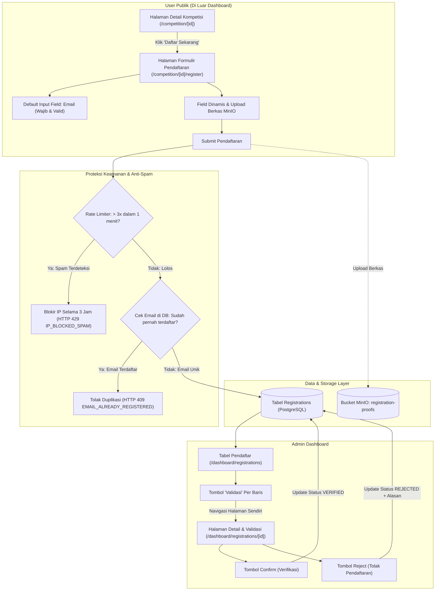

# Spesifikasi Fitur: Pendaftaran Publik & Validasi Admin (Registrations Management)

Dokumen ini mendefinisikan arsitektur teknis Domain-Driven Design (DDD), formulir publik di luar dashboard, validasi email unik per kompetisi, proteksi **Anti-Spam Rate Limiter (Blokir IP 3 Jam)**, serta **Halaman Khusus Validasi Pendaftar** di Admin Dashboard pada platform **Kemas Prasasti 2025**.

---

## 1. Ikhtisar Alur & Arsitektur Fitur

---

## 2. Formulir Pendaftaran Publik (Di Luar Dashboard)

- **Akses Rute Publik:**
  - `/competition/[id]/register`
  - `/register/[competitionId]` (otomatis diarahkan)
- **Komponen Utama:** `fe-app/modules/registration/presentation/components/dynamic-form-renderer.tsx`
- **Default Field Wajib (Email & Nomor WhatsApp / HP):**
  - Setiap formulir pendaftaran secara otomatis menyertakan field **`email`** dan **`phone`** (Nomor WhatsApp / HP Aktif).
  - Wajib format email valid (`z.string().email()`) dan nomor HP minimal 9 digit angka.
  - Dilengkapi petunjuk: *"1 alamat email hanya dapat mendaftar 1 kali pada kompetisi ini. Jika sebelumnya sudah mendaftar, harap hubungi admin."*
- **Penanganan Status Tier Harga (Price List Deprecated Strikethrough):**
  - Tier harga yang berstatus `EXPIRED` ditampilkan dengan efek tercoret (*strikethrough* / `line-through opacity-60 text-muted-foreground`) pada katalog & formulir pendaftaran tanpa kolom status eksplisit.
- **Tampilan Berkas & Label Field pada Admin:**
  - Admin view memetakan key field dinamis (`field_xxx`) ke label asli formulir menggunakan `registration.formSections`.
  - Berkas unggahan peserta dirender langsung inline di baris field terkait dalam bentuk tombol interaktif yang membuka dokumen/gambar di tab baru (`target="_blank" rel="noopener noreferrer"`) menggunakan MinIO Presigned URL aman.
  - Section terpisah `Dokumen & Berkas Unggahan` ditiadakan agar antarmuka ringkas dan langsung terasosiasi dengan konteks pertanyaan.
- **Penanganan Error Duplikasi Email:**
  - Jika user mencoba mendaftar dengan email yang sama pada cabang lomba yang sama, sistem menolak dengan kode `EMAIL_ALREADY_REGISTERED`.
  - Formulir menampilkan banner peringatan amber dan Sonner toast yang menginstruksikan user untuk langsung menghubungi admin via kontak WhatsApp panitia.
- **Layar Sukses Pendaftaran:**
  - Menampilkan Nomor Registrasi resmi (`KP25-REG-...`) dengan tombol salin (copy to clipboard).
  - Status pendaftaran: `Menunggu Verifikasi Admin`.
  - Tombol navigasi kembali ke informasi lomba atau beranda kompetisi.

---

## 3. Proteksi Anti-Spam & Pemblokiran IP 3 Jam

- **Aturan Batas:** Maksimal **3 kali submit dalam 1 menit** per alamat IP.
- **Deteksi Spam & Hukuman Blokir:**
  - Jika seorang pengguna atau bot mencoba mengirim formulir lebih dari 3 kali dalam 1 menit:
    - Alamat IP pengguna **DIBLOKIR SELAMA 3 JAM** (`3 * 60 * 60 * 1000 ms`).
    - Seluruh permintaan pendaftaran dari IP tersebut selama masa blokir langsung ditolak di level middleware Express (`registrationSpamLimiterMiddleware`).
    - Response HTTP 429 menyertakan kode `IP_BLOCKED_SPAM` dan countdown waktu blokir yang tersisa.
    - Pada antarmuka frontend, tombol submit langsung dinonaktifkan dan muncul banner peringatan keamanan merah.

---

## 4. Fitur Validasi Admin (Dedicated Detail Page)

### A. Tombol Aksi di Tabel Pendaftar (`/dashboard/registrations`)
- Pada setiap baris data pendaftar di `RegistrationsTable`, tersedia tombol utama:
  - **`Validasi`** (dengan ikon `FileCheck2` dan border primer).
  - Ketika diklik, langsung mengarahkan (*router.push*) ke halaman khusus: `/dashboard/registrations/[id]`.
  - Dropdown menu juga tetap menyediakan opsi *"Halaman Validasi & Detail"* serta *"Quick Preview (Modal)"*.

### B. Halaman Khusus Validasi Pendaftar (`/dashboard/registrations/[id]`)
- **File Halaman:** `fe-app/app/(dashboard)/dashboard/registrations/[id]/page.tsx`
- **Komponen Presentasi:** `fe-app/modules/registration/presentation/components/registration-validation-view.tsx`
- **Bagian-Bagian Halaman:**
  1. **Header & Status:**
     - Tombol kembali ke tabel pendaftar.
     - Nomor Registrasi pendaftar (`KP25-REG-...`) dengan badge status aktif (`UNVERIFIED`, `VERIFIED`, `REJECTED`).
  2. **Card Target Email Pendaftar & Notifikasi 1-Klik:**
     - Menampilkan alamat email tujuan pendaftar secara transparan.
     - Keterangan sistem: *"Sistem akan mengirimkan email notifikasi otomatis ke alamat ini begitu Anda memvalidasi status (ACC / Tolak)."*
     - Banner status pengiriman live (hijau jika sukses terkirim dengan alamat email tujuan, atau amber peringatan jika pengiriman email gagal beserta rincian error).
  3. **Card Profil & Identitas Peserta:**
     - Nomor registrasi (dengan tombol salin).
     - Alamat email pendaftar unik (dengan tombol salin dan mailto).
     - Nama cabang lomba dan struktur formulir.
     - Tanggal pengiriman lengkap (WIB).
     - Riwayat audit: nama admin yang memverifikasi dan waktu verifikasi (jika sudah divalidasi).
  4. **Card Isian Formulir Dinamis:**
     - Daftar lengkap seluruh field dan nilai isian peserta yang diformat rapi dalam tabel grid.
     - Penanganan berkas unggahan: tombol interaktif dengan nama berkas asli yang membuka berkas di tab baru secara aman menggunakan MinIO presigned URL.
  5. **Card Berkas & Dokumen Bukti (MinIO):**
     - Daftar berkas yang diunggah peserta ke bucket `registration-proofs`.
     - Pratinjau langsung untuk file gambar (*image preview zoom*).
     - Tombol *"Buka Berkas"* (tab baru) dan *"Unduh"*.
  6. **Panel Tindakan Validasi (Action Box & 1-Click Email Dispatch):**
     - Textarea input catatan evaluasi / alasan penolakan.
     - **Tombol Confirm:**
       - Menyetujui pendaftaran dan mengubah status menjadi `VERIFIED`.
       - Dialog konfirmasi memberitahukan: *"Email konfirmasi penerimaan akan otomatis dikirimkan ke [email] secara instan."*
       - 1 kali klik langsung memperbarui status di database DAN mengirim email konfirmasi kelolosan via backend.
     - **Tombol Reject:**
       - Menolak pendaftaran dan mengubah status menjadi `REJECTED`.
       - Dialog konfirmasi mewajibkan catatan alasan penolakan dan memberitahukan: *"Email pemberitahuan penolakan beserta catatan alasan evaluasi akan otomatis dikirimkan ke [email] secara instan."*
       - 1 kali klik langsung memperbarui status di database DAN mengirim email penolakan dengan catatan resmi.
     - **Tombol Reset Status:**
       - Mengembalikan status ke `UNVERIFIED` jika dibutuhkan evaluasi ulang.
     - **Feedback Toast Sonner (top-right):**
       - Menampilkan notifikasi sukses perubahan status dan status pengiriman email (`toast.success` bila email terkirim, `toast.warning` bila status berhasil diupdate namun email gagal terkirim).
  7. **Panel Audit Jaringan & Anti-Spam:**
     - Menampilkan IP Address pendaftar dan User-Agent perangkat pendaftar untuk deteksi fraud.

---

## 5. Ringkasan File Baru & Modifikasi

| Lokasi File | Deskripsi Perubahan |
|---|---|
| `be-app/src/lib/rate-limiter.ts` | In-memory limiter 3x/menit dengan auto-block IP 3 jam jika terdeteksi spam. |
| `be-app/src/middlewares/registration-spam-limiter.middleware.ts` | Express middleware proteksi spam pendaftaran. |
| `be-app/src/modules/registration/infrastructure/registration.table.ts` | Penambahan kolom `email` di tabel PostgreSQL `registrations`. |
| `be-app/src/modules/registration/infrastructure/registration.repository.ts` | Query `findRegistrationByEmail` dan penyimpanan `email`. |
| `be-app/src/modules/registration/infrastructure/registration-email.service.ts` | Service email Nodemailer/Mailpit dengan HTML responsive template status VERIFIED & REJECTED. |
| `be-app/src/modules/registration/application/registration.service.ts` | Eksekusi otomatis pengiriman email status pada use case `updateRegistrationStatusService`. |
| `be-app/src/modules/registration/presentation/registration.controller.ts` | Response API diperkaya dengan field `emailSent`, `emailRecipient`, dan `emailError`. |
| `fe-app/modules/registration/domain/registration.interface.ts` | Tipe data `UpdateRegistrationStatusResult` dengan status email delivery. |
| `fe-app/modules/registration/application/registration.actions.ts` | Server Action `updateRegistrationStatusAction` mengembalikan hasil pengiriman email. |
| `fe-app/modules/registration/presentation/components/registration-validation-view.tsx` | Halaman validasi admin dengan panel preview email target, live email delivery alert banner, dan notifikasi toast Sonner komprehensif. |
| `fe-app/modules/registration/presentation/components/registration-detail-dialog.tsx` | Dialog preview pendaftar dengan indikator pengiriman email otomatis dan toast feedback. |
| `be-app/src/modules/registration/application/registration.service.ts` | Validasi wajib email, cek duplikasi email per lomba, dan rate limit. |
| `fe-app/lib/api-client.ts` | Meneruskan header `x-forwarded-for` dan `user-agent` ke backend. |
| `fe-app/modules/registration/presentation/components/dynamic-form-renderer.tsx` | Default field email wajib, deteksi IP block banner, dan form submission. |
| `fe-app/app/(detail)/competition/[id]/register/page.tsx` | Halaman formulir pendaftaran online publik di luar dashboard. |
| `fe-app/app/(landing)/register/[competitionId]/page.tsx` | Route alias pendaftaran publik. |
| `fe-app/app/(dashboard)/dashboard/registrations/[id]/page.tsx` | Halaman server component detail & validasi admin. |
| `fe-app/modules/registration/presentation/components/registration-validation-view.tsx` | Komponen interaktif validasi dengan tombol Confirm, Reject, dan berkas MinIO. |
| `fe-app/modules/registration/presentation/components/registrations-table.tsx` | Penambahan tombol `Validasi` di setiap baris tabel pendaftar. |
| `be-app/docs/api/registration-api.md` | Dokumentasi spesifikasi kontrak REST API pendaftaran & validasi. |
| `fe-app/docs/feateures/registration-management.md` | Dokumentasi spesifikasi teknis pendaftaran & validasi admin. |
