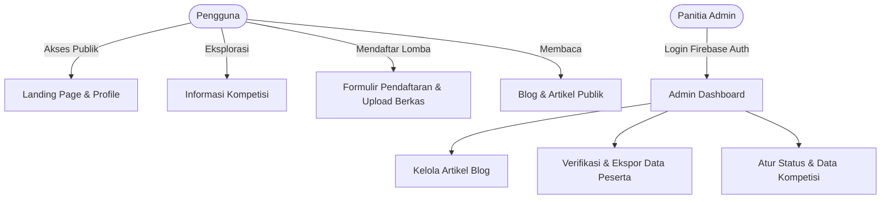

# Project Overview: Kemas Prasasti 2025

## 1. Latar Belakang & Identitas
**Kemas Prasasti 2025** adalah kegiatan tahunan berskala besar yang diselenggarakan oleh organisasi kemahasiswaan/kepemudaan "Kemas Prasasti". Proyek ini berfokus pada penyediaan platform digital terpadu berbasis web yang berfungsi sebagai:
- **Wajah Publik (Company/Event Profile):** Memperkenalkan identitas organisasi, tema tahun ini, visi-misi, susunan acara, dan timeline kegiatan.
- **Pusat Informasi & Pendaftaran Kompetisi:** Menyediakan panduan lengkap cabang lomba serta alur registrasi online yang mudah bagi para peserta.
- **Media Publikasi & CMS Blog:** Sarana rilis berita kegiatan, artikel edukatif, dokumentasi, dan liputan acara.
- **Pusat Kendali Administrasi (Admin Dashboard):** Panel kontrol bagi panitia untuk mengelola pendaftar, memvalidasi bukti pembayaran, dan mempublikasikan konten secara dinamis.

---

## 2. Pengguna Sistem (User Personas)

1. **Pengunjung Umum (Public Guest):**
   - Melihat informasi organisasi, tema kegiatan, galeri, dan kontak panitia.
   - Membaca artikel dan blog seputar kegiatan Kemas Prasasti.
   - Menelusuri daftar kompetisi yang dibuka, hadiah, dan buku panduan (rulebook).

2. **Calon Peserta Kompetisi (Registrant):**
   - Memilih cabang kompetisi (misal: Futsal, Mobile Legends, Try Out, atau kompetisi lainnya).
   - Mengisi formulir pendaftaran dinamis sesuai persyaratan masing-masing lomba.
   - Mengunggah berkas persyaratan (bukti bayar, kartu tanda pelajar/mahasiswa, logo tim).
   - Menerima konfirmasi pendaftaran.

3. **Panitia / Administrator (Admin):**
   - Login ke dashboard terproteksi via Firebase Authentication.
   - Mengelola status pendaftaran (meninjau berkas, memvalidasi pembayaran, menyetujui/menolak).
   - Mengelola konten blog (menulis artikel baru, mengedit, menghapus, mengelola tag/kategori).
   - Mengelola informasi lomba (jadwal, status buka/tutup pendaftaran, update contact person).
   - Mengunduh/mengekspor data peserta untuk kebutuhan operasional panitia di lapangan.

---

## 3. Ruang Lingkup Sistem

---

## 4. Prioritas Pengembangan (Tahapan)

1. **Fase Fondasi:**
   - Standarisasi aturan kerja agen (`AGENTS.md`, `.agents/rules/`).
   - Penyelarasan arsitektur database (integrasi Prisma ORM dan Firebase).
   - Dokumentasi lengkap spesifikasi dan skema data.
2. **Fase Modul Publik & Pendaftaran:**
   - Penyempurnaan halaman landing dan detail kompetisi.
   - Pembangunan formulir pendaftaran dinamis dengan validasi Zod.
3. **Fase Admin Dashboard & Autentikasi:**
   - Setup Firebase Auth (Role-based access untuk Admin).
   - Antarmuka dashboard manajemen pendaftar & verifikasi berkas.
4. **Fase Web CMS Blog:**
   - Rich-text editor atau markdown editor untuk penulisan artikel.
   - Publikasi dan rendering halaman detail artikel yang SEO-friendly.
5. **Fase Realtime & Finishing:**
   - Notifikasi / pembaruan status realtime menggunakan Firebase Realtime Database / Firestore.
   - Pengujian end-to-end dan optimasi performa.

